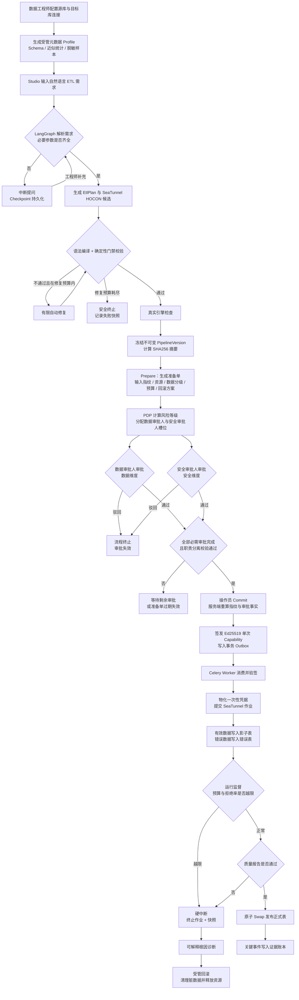
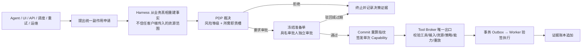
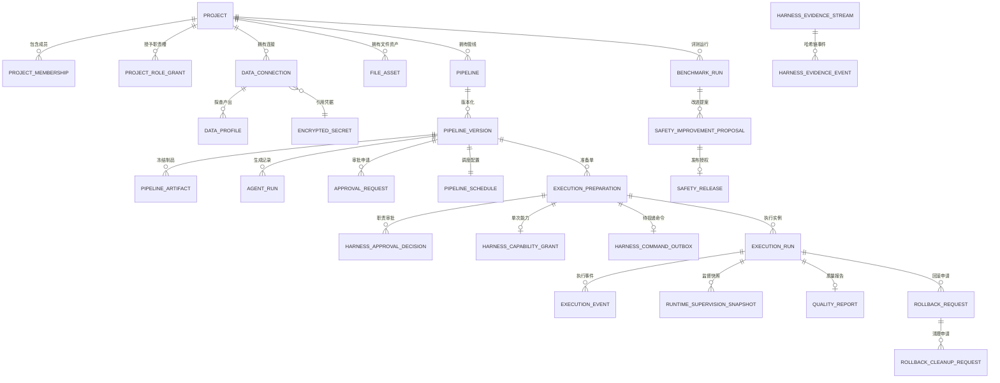

# 生产级 ETL-Agent 数据集成平台 需求规格说明书（PRD）

> | 项 | 内容 |
> |----|------|
> | 文档名称 | 生产级 ETL-Agent 数据集成平台 需求规格说明书（PRD） |
> | 版本 | v1.2 |
> | 作者角色 | 产品经理 |
> | 日期 | 2026-10-15（最近修订 2026-10-16） |
> | 状态 | 评审稿（Q1~Q7 已决策，**无未决问题**） |
> | 修订说明 | v1.1 确立「以需求基线为准」原则，新增 §11.1 待补齐项与 FR-103；**v1.2 完成 Q1~Q7 全部决策并回写章节** —— 修复轮次定为 3 轮、双场景均为必过项、练手项目定档（不设容量与合规硬指标）、超集能力纳入验收、逐行 LLM 按参考实现交付；§11.2 由「待确认」转为「决策记录」 |
> | 项目代号 | data-integration-platform |
> | 需求基线 | 《大模型就业项目实战.md》§2.8 生产级 ETL-Agent 数据集成平台 |
> | 参考实现 | `ETL-Agent(Harness)/3.代码/etl_agent`（课程参考代码，用于核实技术事实，不作为需求来源） |

---

## 0. 文档说明与需求基线

本节说明本文档「哪些是要求、哪些是已核实的事实」，避免后续把参考实现当成需求、或把需求当成已完成。

**三层信息来源**

| 层级 | 来源 | 在本文档中的作用 |
|------|------|-----------------|
| 需求基线 | 《大模型就业项目实战.md》§2.8（含 2.8.1 ~ 2.8.10） | 定义「要做什么」，是验收的唯一依据 |
| 事实核实 | 参考实现 `etl_agent` 源码 + 21654 行课件 | 核实技术细节、补齐量化指标；**不作为需求增项** |
| 差异处置 | 两者不一致处 | **一律以需求基线为准**，不擅自取舍；参考实现相对基线的欠缺统一记入 §11.1「实现待补齐项」，**不作为待确认问题** |

**已核实的关键事实**（来自参考实现，本文档多处引用）

| 事实项 | 实测值 | 核实方式 |
|--------|--------|---------|
| 数据库表 | 41 张 | `models.py` 中 `__tablename__` 计数 |
| API 端点 | 97 个 / 18 个 Router | `api/routes/*.py` 中 `@router.` 计数 |
| 应用服务 | 48 个文件 | `application/*.py` 计数 |
| 基础设施适配器 | 23 个文件（含 3 个 SeaTunnel Adapter） | `infrastructure/**` 计数 |
| Celery 任务入口 | 14 个 | `*_tasks.py` |
| 元数据探查器 | 7 个：MySQL / Doris / PostgreSQL / Oracle / SQL Server / Hive / HDFS | `probe_registry.py` |
| Benchmark 用例 | 14 条（L0 9 条 + L1 5 条） | `benchmarks/harness-v2/v1/scenarios.json` |
| Benchmark 门槛 | 见 §5 | `baseline.json` |
| 运行时硬上限 | 见 §5 | `config.py` + `supervision.py::RuntimeBudget` |
| 测试规模 | 64 个文件 / 12,262 行 | `tests/**` 计数 |
| 离线镜像附件 | 2 个：基础镜像 ≈155 MB（postgres:17-alpine + redis:8-alpine）、E2E 扩展镜像 ≈7.6 GB（mysql:8.4 + doris fe/be 3.0.8 + flowpilot/seatunnel:2.3.13） | `Docker镜像/` 实测 + 附件 README |
| 前端 | Vue 3 + TypeScript 单页应用，5 个视图，`App.vue` 2086 行 | `frontend/src/App.vue` |

> **差异处置原则（重要）**：本文档**以《大模型就业项目实战.md》§2.8 为唯一需求基线**。参考实现（课程官方代码）仅用于核实技术细节，**它没有实现基线要求的能力，不等于需求可以降低**。遇到两者不一致时一律按「需求为准」，并把参考实现的欠缺登记为 §11.1 的「实现待补齐项」——这是一份**任务清单**，不是待拍板的问题。
>
> 已识别的主要差异：需求基线 §2.8.1 要求接入 ClickHouse 数据源、S3/MinIO 与 REST API 数据源，参考实现均无对应连接器；需求基线列出的文件格式与参考实现支持范围不一致。上述差异的处置结论见 §11.1。

---

## 1. 产品目标与价值

### 1.1 背景与要解决的问题

企业数据集成的输入极少是完整技术规格。业务方通常只给一句话：

> “把 MySQL 的订单同步到 Doris，清理客户名称，金额必须为正，邮箱要脱敏，错误数据单独保存，每天凌晨执行。”

这句话背后隐藏了大量必须补齐的工程事实：源库与目标库属于哪个项目、表和字段是否真实存在、类型能否对齐、「正数」是否允许空值、错误表保留哪些列、全量还是增量、重试会不会重复写入、生产发布由谁批准、失败后如何回滚。

现有三种做法都无法同时满足企业要求：

| 现状 | 问题 |
|------|------|
| 手写 ETL 脚本 | 无统一治理，权限、审计、回滚全靠个人习惯 |
| 拖拽式 ETL 平台 | 无法理解自然语言需求，配置成本高，无 Agent 澄清能力 |
| 通用聊天机器人 | 能生成配置但无法证明「批准的内容 = 执行的内容」，无法进生产 |

**核心痛点**：模型能生成配置，但无法回答「谁批准了哪份内容、哪项能力被授予、外部系统实际发生了什么、失败后如何限制影响」。缺少这层工程约束，Agent 只能停留在 Demo。

### 1.2 建设目标

建设面向企业异构数据集成场景的**生产级 ETL-Agent 控制面平台**，把一句业务话变成**受管、可审查、可审批、可执行、可回放**的数据任务。具体目标：

1. **需求要能落地**：自然语言需求经受限元数据探查、结构化 EtlPlan 生成、确定性门禁校验，产出不可变 Pipeline 版本。
2. **副作用要能管住**：所有产生外部副作用的动作统一经过 `prepare → approve → commit` 三阶段协议与单次 Capability 授权，Agent、UI、API、调度、重试、取消、回滚、凭据治理不各写一套权限判断。
3. **责任要能落到人**：强制四眼原则与职责分离，申请人禁止自批，高风险操作禁止同一人占多个审批槽位。
4. **执行要能证明**：关键事件进入带哈希链与签名检查点的证据账本，可回放、可审计。
5. **风险要能收敛**：运行时按冻结预算监督，超限硬中断；发布前质量契约把关；异常可受管回滚。
6. **退化要能拦住**：版本化 Benchmark 同时惩罚漏报、误报与证据缺失，P0/P1 漏拦即阻断发布。

**不做的事（避免范围失控）**：不重写数据集成引擎（数据搬运交给 SeaTunnel）；不让模型拥有最终裁决权；不允许 Agent 自行审批、自行修改生产策略或运行中代码。

### 1.3 成功标准（可量化）

| 编号 | 指标 | 目标值 | 来源 / 依据 |
|------|------|--------|------------|
| G-01 | P0/P1 风险阻断率 | **= 100%** | `baseline.json → thresholds.p0_p1_block_rate = 1.0`（漏拦即发布失败） |
| G-02 | 合法任务成功率 | **≥ 95%** | `thresholds.legitimate_success_rate = 0.95` |
| G-03 | 策略误报率 | **≤ 5%** | `thresholds.false_positive_rate = 0.05` |
| G-04 | 证据覆盖率 | **= 100%** | `thresholds.evidence_coverage_rate = 1.0` |
| G-05 | 冻结输入决策复现率 | **= 100%** | `thresholds.reproducibility_rate = 1.0`（同一输入执行两次结果一致） |
| G-06 | Harness 非 LLM 路径 P95 延迟回归 | **≤ 20%**（基线 20 ms） | `thresholds.non_llm_p95_max_regression = 0.2`，`non_llm_p95_ms = 20.0` |
| G-07 | 敏感明文泄露事件 | **= 0**（Prompt / Artifact / 日志 / Trace / 证据 / 消息队列全链路） | §2.8.10 验收标准第 2 条 |
| G-08 | 申请人自批拦截率 | **= 100%** | §2.8.2 强制职责分离规则 |
| G-09 | 单次 Capability 重复消费成功率 | **= 0**（第二次使用必须失败） | §2.8.4 防重放与单次能力规则 |
| G-10 | 端到端演示链路完成度 | **2 条基线场景全部贯通**（MySQL→Doris 宽表增量同步、文件→Doris 日志入库） | §2.8.9 示例业务场景 + 决策 **Q2** |

> **口径说明**：G-01 ~ G-06 直接采用参考实现的冻结阈值（可被 CI 判定），不是估计值。G-07 ~ G-10 来自需求基线验收标准，属业务口径，需在验收阶段以实测证据闭环。

---

## 2. 用户角色与权限矩阵

### 2.1 业务角色（需求基线定义）

| 角色 | 职责描述 | 核心权限 |
|------|---------|---------|
| **数据工程师（Maker）** | 登记数据源连接、发起元数据探查、输入自然语言需求、调试并生成 Pipeline 候选方案、提交不可变版本与审批申请 | 创建/编辑本人负责的连接与 Pipeline 草稿；发起元数据探查；触发 Agent 生成与门禁校验；提交审批申请；查看本项目 Pipeline 与运行状态。**不可审批自己提交的内容** |
| **数据审批人（Checker 1）** | 审查需求描述、Schema 字段映射、脱敏前后结构对比、质量规则与 DAG 结构，执行**数据维度**审批 | 审批/驳回**数据维度**门禁；查看审批所需的冻结事实（DAG、字段映射 Diff、脱敏前后对比、质量契约、原始配置）；查看本项目数据资产与 Profile |
| **安全审批人（Checker 2）** | 审查资源范围、数据敏感分级、执行预算、Secret 引用与回滚方案，执行**安全维度**审批；管理 Benchmark 与安全策略 | 审批/驳回**安全维度**门禁；查看资源范围、数据分级报告、运行预算与回滚方案；触发 Benchmark 评测；审查安全改进候选并管理影子/小流量授权 |
| **系统操作员（Operator）** | 在所有审批通过后执行 Commit 操作、触发受管执行、监控运行状态、执行任务暂停/取消/回滚与凭据轮转 | 执行 Commit（签发单次 Capability）；触发/取消执行；发起回滚与清理申请；执行凭据轮转与销毁；管理调度开关。**不可审批自己发起的申请** |
| **审计人员（Auditor）** | 查看执行历史、审计事件、签名证据账本、数据质量报告与 Benchmark 评测大盘 | 只读：全部执行历史、审计事件、证据账本验证、质量报告、Benchmark 报告。**无写权限，不能参与审批与执行** |

### 2.2 强制职责分离规则（属红线，系统必须强制）

| 编号 | 规则 | 拦截点 |
|------|------|--------|
| SOD-01 | **申请人禁止自批**：Pipeline 提交人与数据/安全审批人必须是不同自然人 | Prepare/Approve 阶段身份校验 |
| SOD-02 | **高风险操作禁止一人多槽**：P0 风险操作的数据审批槽与安全审批槽必须由不同人担任 | PDP 输出 required_roles 后，Approve 阶段校验 |
| SOD-03 | **执行人与审批人分离**：Commit 操作员不得同时是本次审批的审批人 | Commit 阶段身份校验 |
| SOD-04 | **审批绑定内容**：审批绑定冻结的 Artifact 摘要与输入指纹，内容变化即审批失效 | 审批记录与 Artifact SHA256 绑定 |
| SOD-05 | **审计只读**：审计人员不可参与任何审批、执行与写操作 | 路由级权限校验 |

### 2.3 两套角色的映射关系（实现事实，供研发与 UI 对齐）

参考实现中角色分两层，权限矩阵必须两层都覆盖：

| 层级 | 枚举 | 取值 | 作用 |
|------|------|------|------|
| 项目成员角色 | `ProjectRole` | `ADMIN` / `DATA_ENGINEER` / `APPROVER` / `VIEWER` | 控制项目内资源的增删改查可见性 |
| Harness 职责槽 | `HarnessRole` | `DATA_ENGINEER` / `DATA_APPROVER` / `SECURITY_APPROVER` / `OPERATOR` / `AUDITOR` | 控制审批槽位、Capability 签发与执行授权 |

映射规则：项目成员角色授予「能碰什么资源」，Harness 职责槽授予「能批准/执行什么动作」。`ADMIN` 负责把成员映射到职责槽（`project_role_grants` 表）。业务角色「数据审批人」「安全审批人」分别对应 `DATA_APPROVER` 与 `SECURITY_APPROVER` 两个**独立**职责槽，不可由同一人同时持有（SOD-02）。

---

## 3. 用户故事

### 3.1 数据工程师（Maker）

- **US-01**：作为数据工程师，我希望用自然语言描述 ETL 需求（源端、目标端、清洗规则、错误处理、调度），以便不必手写 SeaTunnel HOCON 配置。
- **US-02**：作为数据工程师，我希望系统在需求参数缺失时主动中断提问（如「增量水位列未指定」），我补充后从中断处继续，以便不用从头重述需求。
- **US-03**：作为数据工程师，我希望登记 MySQL / PostgreSQL / Oracle / Doris 等异构数据源并执行**只读**连通性测试，以便在不暴露生产密码的前提下确认可用性。
- **US-04**：作为数据工程师，我希望发起元数据探查并获得 Schema、字段类型、主键、近似统计与**脱敏样本**，以便让模型基于真实结构生成方案，且原始业务行不进入模型上下文。
- **US-05**：作为数据工程师，我希望导入本地/受管文件（CSV、JSON、Excel、Parquet 等）作为数据源，以便一次性文件也能纳入受管流程。
- **US-06**：作为数据工程师，我希望模型生成的候选配置能自动经过确定性门禁（连接器、DAG、字段、SQL 分流、质量错误码、Secret 占位符、Doris 投影）校验，非法结构进入有限修复而非直接执行。
- **US-07**：作为数据工程师，我希望在拓扑审查区看到 EtlPlan、HOCON、DAG 拓扑图、字段映射 Diff 与脱敏前后结构对比，以便自主判断方案是否正确。
- **US-08**：作为数据工程师，我希望修改需求时系统创建**新版本（V+1）**而非覆盖旧版本，以便版本可追溯、可回滚。
- **US-09**：作为数据工程师，我希望提交审批时系统冻结不可变版本并计算 SHA256 摘要，以便审批人看到的就是将要执行的内容。

### 3.2 审批人（Checker）

- **US-10**：作为数据审批人，我希望在审批面板看到本次执行的影响范围、字段映射、质量规则与脱敏前后对比，以便只对**数据正确性**负责。
- **US-11**：作为安全审批人，我希望看到资源范围、数据敏感分级、执行预算配额、Secret 引用方式与回滚方案，以便只对**安全与资源**负责。
- **US-12**：作为任何审批人，我希望系统强制「申请人不能自批」，且高风险操作必须由不同人分别担任数据与安全审批槽，以便职责分离不被绕过。
- **US-13**：作为审批人，我希望审批绑定到具体 Artifact 摘要而非任务名称，内容被替换时旧审批自动失效，以便防范审批后篡改。

### 3.3 系统操作员（Operator）

- **US-14**：作为系统操作员，我希望在所有必需审批完成后执行 Commit，由系统服务端重新校验指纹与审批事实并签发**短时单次** Capability，以便授权不依赖客户端自述。
- **US-15**：作为系统操作员，我希望 Commit 后由 Celery Worker 消费受管命令、验签后调用 SeaTunnel 执行，以便不因单点故障产生「无本地事实的远端作业」。
- **US-16**：作为系统操作员，我希望在运行中心实时查看吞吐、读取行数、写入字节、错误分流与质量报告，以便及时判断运行是否正常。
- **US-17**：作为系统操作员，我希望在异常或超预算时收到可解释根因诊断（错误分类 + 修复建议），并能一键发起**受管回滚**，以便快速恢复而无需手工清库。
- **US-18**：作为系统操作员，我希望执行暂停/取消/回滚/清理与凭据轮转都必须走同一受管入口，以便不存在绕过 Harness 的运维旁路。
- **US-19**：作为系统操作员，我希望配置调度策略（批量 / 水位增量）、触发时刻与失火策略，以便任务按业务节拍自动运行。

### 3.4 安全审批人与审计人员（治理）

- **US-20**：作为安全审批人，我希望触发版本化 Benchmark 评测集并查看 P0/P1 拦截率、合法成功率、误报率、证据覆盖率大盘，以便在放行改动前证明没有安全退化。
- **US-21**：作为安全审批人，我希望安全改进候选经独立审批后只生成**影子/小流量授权**，且出现 P0/P1 回归时自动撤销，以便防止 Agent 自行修改生产策略。
- **US-22**：作为审计人员，我希望查看带哈希链与签名检查点的证据账本，并能验证其完整性，以便确认关键事件未被篡改。
- **US-23**：作为审计人员，我希望回放一次执行的完整决策链（策略命中 → 准备单 → 审批 → 授权 → 投递 → 运行 → 发布），以便定位责任与问题。
- **US-24**：作为审计人员，我希望所有审计记录只含必要摘要与安全指标、不含明文密码与原始业务数据，以便合规且不产生新的敏感数据仓库。

---

## 4. 功能需求清单（需求池）

优先级定义：**P0** 必须（缺失则主流程不通或安全边界不成立）／**P1** 重要（显著影响可用性与可运维性）／**P2** 可选（增强）。

### 4.1 身份、项目与成员治理

| 编号 | 模块 | 功能 | 优先级 | 说明 |
|------|------|------|--------|------|
| FR-01 | 身份与租户 | 用户认证与身份识别 | P0 | 支持本地开发身份与生产可信网关身份两种模式；生产必须使用可信网关签名，禁止客户端自行伪造身份（对应 US-01、US-14） |
| FR-02 | 身份与租户 | 多租户项目隔离 | P0 | 连接、Profile、Pipeline、执行、审批全部按项目隔离，跨项目资源访问按 P0 拒绝（对应 US-04） |
| FR-03 | 身份与租户 | 项目创建与成员管理 | P0 | 创建项目、添加/移除成员、授予项目成员角色（对应 US-12） |
| FR-04 | 身份与租户 | 项目成员角色 ↔ Harness 职责槽映射 | P0 | 管理员把成员映射到 DATA_APPROVER / SECURITY_APPROVER / OPERATOR / AUDITOR 等职责槽（对应 SOD-02） |
| FR-05 | 身份与租户 | 首次初始化（Bootstrap）一次性动作 | P1 | 创建首位管理员；必须在初始化后关闭并撤销令牌，不允许长期开启 |
| FR-06 | 身份与租户 | 职责分离强制校验 | P0 | 拦截申请人自批、一人占多个审批槽、执行人与审批人重叠（对应 SOD-01~SOD-03） |

### 4.2 数据源连接与元数据安全探查

| 编号 | 模块 | 功能 | 优先级 | 说明 |
|------|------|------|--------|------|
| FR-07 | 连接管理 | 异构数据库连接登记（增删改查） | P0 | **覆盖需求基线 §2.8.1 列出的全部数据库类型：MySQL、PostgreSQL、Oracle、Doris、ClickHouse**。参考实现已具备 SQL Server、Hive、HDFS 探查能力，属能力超集（加分项，不替代基线要求） |
| FR-08 | 连接管理 | 连接配置更新与只读连通性测试 | P0 | 测试结果落库为连接状态（未测试/测试中/就绪/失败）；测试过程不得回显秘密（对应 US-03） |
| FR-09 | 连接管理 | 文件与对象存储数据源接入 | P0 | 支持本地上传/登记文件资产，以及 **S3/MinIO 对象存储**接入（需求基线 §2.8.1 明确要求）；格式范围见 §8.4；校验单文件大小与行数上限（对应 US-05） |
| FR-103 | 连接管理 | REST API 数据源接入 | P0 | 按需求基线 §2.8.1「文件与 API 数据源接入」要求，支持 REST API 作为数据源；外发/调用需声明目标出口并受工具契约与出口白名单约束 |
| FR-10 | 元数据探查 | 只读元数据探查（Schema / 字段类型 / 主键） | P0 | 通过受限查询获取元数据，**不允许**无界全表 COUNT，不允许模型生成探查 SQL（对应 US-04） |
| FR-11 | 元数据探查 | 近似统计采集 | P1 | 采集近似行数、空值率等等级统计，供生成阶段参考 |
| FR-12 | 元数据探查 | 脱敏样本采样 | P0 | 按保守脱敏规则处理敏感字段（如邮箱、手机号、姓名、证件号）；样本脱敏后入库，原文不落盘（对应 G-07） |
| FR-13 | 元数据探查 | Profile 时效与状态管理 | P0 | Profile 有有效期与状态（待处理/运行中/就绪/失败）；过期或非就绪的 Profile 不可用于生成（「Profile 是有时效的事实，不是永久 Schema」） |
| FR-14 | 元数据探查 | 数据端点角色标注（Source / Sink） | P1 | 连接或资产需标注在方案中是源端还是目标端 |
| FR-15 | 元数据探查 | 探查任务异步化 | P1 | 探查等外部数据库调用经 Celery 隔离，避免阻塞控制面请求 |

### 4.3 受管凭据与 Secret 全生命周期

| 编号 | 模块 | 功能 | 优先级 | 说明 |
|------|------|------|--------|------|
| FR-16 | 凭据治理 | 凭据受管加密存储 | P0 | 支持本地加密存储与 Vault KV v2 两种 Provider；凭据永不进入模型上下文、API 响应与普通日志（对应 G-07） |
| FR-17 | 凭据治理 | Secret 引用与占位符机制 | P0 | Pipeline 配置中只保存 Secret 引用与占位符，不保存明文；门禁校验占位符合法性 |
| FR-18 | 凭据治理 | Secret Provider 迁移 | P1 | 支持在 Provider 之间迁移凭据；迁移过程**不销毁**源凭据，可回退 |
| FR-19 | 凭据治理 | Secret 轮换（暂存→验证→激活） | P1 | 轮换分阶段执行，激活前需验证新凭据可用；支持轮换回退 |
| FR-20 | 凭据治理 | Secret 轮换回退 | P1 | 激活后发现问题可回退到旧凭据 |
| FR-21 | 凭据治理 | Secret 销毁 | P1 | 对轮换源凭据或已回退的暂存凭据执行受管销毁，需审批 |
| FR-22 | 凭据治理 | 凭据到期告警与 Webhook 投递 | P1 | 到期前预警、到期后逾期告警；通过 Webhook 外发，接收端按投递 ID 幂等 |
| FR-23 | 凭据治理 | 凭据相关操作全部纳入 Harness | P0 | 迁移/轮换/回退/销毁均属受管副作用，不得走旁路（对应 US-18） |

### 4.4 需求解析、LangGraph 编排与智能生成

| 编号 | 模块 | 功能 | 优先级 | 说明 |
|------|------|------|--------|------|
| FR-24 | 智能生成 | 自然语言需求输入 | P0 | 提供需求输入与源端/目标端选择（对应 US-01） |
| FR-25 | 智能生成 | LangGraph 生成状态机编排 | P0 | 组织「意图解析 → 元数据探查 → 生成 EtlPlan/HOCON → 确定性门禁 → 试运行 → 准备审批」流程 |
| FR-26 | 智能生成 | 中断提问与参数澄清 | P0 | 必要参数缺失时中断并向用户提问，不得臆造参数（对应 US-02） |
| FR-27 | 智能生成 | Checkpoint 持久化与恢复 | P0 | 状态跨请求持久化；补充信息后从同一 `thread_id` 恢复，不从零重跑（对应 US-02） |
| FR-28 | 智能生成 | 多模型 Provider 适配 | P1 | 支持 OpenAI 兼容协议接入多个模型服务；生成后端可在直连生成与引擎黑盒路径间切换，切换只影响「候选如何产生」，不影响后续门禁/审批/授权 |
| FR-29 | 智能生成 | 结构化 EtlPlan 生成 | P0 | 模型产出结构化计划（源/目标、映射、转换、质量规则、预算）；由 Schema 约束限制输出结构 |
| FR-30 | 智能生成 | SeaTunnel HOCON 候选生成 | P0 | 基于 EtlPlan 生成 HOCON 配置候选 |
| FR-31 | 智能生成 | 语法与 Schema 对齐校验 + 有限自动修复 | P0 | 候选总量**上限 3 份**（首次生成 1 份 + 最多 2 次修复，决策 Q1）；**候选完整性失败、确定性门禁失败、真实引擎检查失败三类共享同一预算计数**，防止各类各自重试造成预算绕过；预算耗尽后安全终止并给出明确失效原因，不得降级放行（对应 US-06） |
| FR-32 | 智能生成 | 生成过程可观测（AgentRun） | P1 | 记录一次生成的输入、澄清轮次、修复次数、产出摘要与状态（排队/运行中/等待输入/等待审批/失败） |
| FR-33 | 智能生成 | 逐行 LLM Transform 开关 | P2 | **按参考实现交付**（决策 Q7）：能力保留但默认**严格关闭**；开启需独立 API Key、出口主机白名单与速率限制（≤ 10 行/秒），且与「生成 Pipeline 的模型」使用独立开关与密钥 |

### 4.5 确定性门禁、不可变版本与调度配置

| 编号 | 模块 | 功能 | 优先级 | 说明 |
|------|------|------|--------|------|
| FR-34 | 门禁与版本 | 确定性静态门禁校验 | P0 | 校验连接器合法性、DAG 结构、字段与类型对齐、SQL 分流、质量错误码、Secret 占位符、Doris 投影（对应 US-06） |
| FR-35 | 门禁与版本 | 真实引擎检查 | P0 | 通过静态门禁后经真实 SeaTunnel 检查，通过后才允许冻结 Artifact |
| FR-36 | 门禁与版本 | 不可变版本冻结 + SHA256 摘要 | P0 | 冻结 HOCON、EtlPlan 与审查视图为不可变 Pipeline 版本并计算摘要（对应 US-09） |
| FR-37 | 门禁与版本 | 版本状态机与非法跃迁拒绝 | P0 | 状态流转：草稿 → 探查 → 已生成 → 已校验 → 等待审批 → 已批准/已驳回；拒绝跳步、非法回退与终态重启 |
| FR-38 | 门禁与版本 | 版本 Diff 对比 | P1 | 对比不同版本的 Schema、HOCON 与质量规则差异 |
| FR-39 | 门禁与版本 | 修改需求创建新版本 | P0 | 需求变更必须创建 V+1，不覆盖旧版本（对应 US-08） |
| FR-40 | 门禁与版本 | 调度策略配置 | P0 | 配置批量 / 水位增量模式、触发时刻、失火策略（跳过/补一次），并冻结触发时刻与水位窗口（对应 US-19） |

### 4.6 Harness 安全内核

| 编号 | 模块 | 功能 | 优先级 | 说明 |
|------|------|------|--------|------|
| FR-41 | Harness | 工具契约清单（ToolManifest） | P0 | 工具必须声明版本、输入输出 Schema、副作用类型、资源范围、超时、记录/字节上限、幂等性与补偿工具；未注册工具、版本不匹配、输入越界一律拒绝 |
| FR-42 | Harness | 策略决策点（PDP，P0–P3 风险分级） | P0 | 基于 ToolIntent、资源范围、环境、数据分级与工具副作用输出「允许 / 拒绝 / 要求审批 / 延迟」及所需职责槽与审批人数 |
| FR-43 | Harness | 数据分类报告 | P0 | 先对 Schema 做字段级数据分类（公开/内部/机密/受限/秘密/未知）并冻结报告，作为 PDP 与监督层的共同输入；分类缺失按 UNKNOWN 保守处理 |
| FR-44 | Harness | Tool Broker 唯一出口 | P0 | 所有副作用执行必须经 Broker；执行前重新校验工具清单、输入、资源、策略、能力与重放状态（对应 US-18） |
| FR-45 | Harness | Capability 签发与校验（Ed25519） | P0 | 签发绑定工具、主体、环境、Artifact 指纹与监督契约的短时**单次**令牌（默认 5 分钟）；支持防篡改、过期、跨环境与重复使用校验（对应 US-14） |
| FR-46 | Harness | Replay Guard 防重放 | P0 | 持久化原子消费能力令牌，第二次使用必须失败（对应 G-09） |
| FR-47 | Harness | 事务 Outbox | P0 | 在同一 PostgreSQL 事务中原子创建执行记录与待投递命令；API 崩溃后可重投，不会产生无本地事实的远端作业（对应 US-15） |
| FR-48 | Harness | 证据账本（Evidence Ledger） | P0 | 对关键事件建立追加式哈希链与签名检查点；支持完整性验证，能发现删除、插入、改写与伪造检查点（对应 US-22） |
| FR-49 | Harness | 策略包版本化与签名 | P1 | 策略包以版本化清单 + 分离签名发布；决策记录策略包版本与规则命中证据，可追溯、可回滚 |
| FR-50 | Harness | 失败关闭（fail-closed）分级 | P0 | 策略、审批、签名、证据或 Secret 无法验证时，写入/删除/外发/密钥使用不得降级放行 |

### 4.7 审批与 `prepare → approve → commit` 协议

| 编号 | 模块 | 功能 | 优先级 | 说明 |
|------|------|------|--------|------|
| FR-51 | 三阶段协议 | Prepare：生成执行准备单 | P0 | 推导输入指纹、资源范围、影响范围、数据分级、运行预算与回滚方案，冻结准备单，**不产生任何外部副作用** |
| FR-52 | 三阶段协议 | 准备单有效期管理 | P0 | 准备单默认 24 小时有效；过期后审批与提交均失效（与 Capability 5 分钟 TTL 相互独立） |
| FR-53 | 三阶段协议 | Approve：具名独立审批 | P0 | 具名审批人基于冻结事实审批；支持数据维度与安全维度分离；支持 APPROVE / REJECT；拒绝、过期或内容变化使旧审批失效（对应 US-10、US-11） |
| FR-54 | 三阶段协议 | 审批槽位分配 | P0 | 依据 PDP 输出的 required_roles / required_approvals 分配审批槽，并校验职责分离（对应 SOD-02） |
| FR-55 | 三阶段协议 | Commit：服务端重建事实并签发 Capability | P0 | Commit 不信任客户端传入的风险级别、工具版本或资源范围，从服务端重建事实，重新校验审批与 Artifact 后签发单次 Capability（对应 US-14） |
| FR-56 | 三阶段协议 | 审批与执行事实查询 | P1 | 提供审批申请、审批决策、准备单与执行记录的查询接口，供控制台与审计使用 |
| FR-57 | 三阶段协议 | 统一副作用申请入口 | P0 | 取消、回滚、清理、凭据迁移/轮换/回退/销毁等全部通过同一申请—审批—提交入口（对应 FR-23、US-18） |

### 4.8 异步执行、调度与 SeaTunnel 对接

| 编号 | 模块 | 功能 | 优先级 | 说明 |
|------|------|------|--------|------|
| FR-58 | 执行 | Celery Worker 消费受管命令 | P0 | Worker 在读取 Secret 与接触引擎前，再次用公钥验证能力声明并检查冻结 Artifact 与监督契约（对应 US-15） |
| FR-59 | 执行 | 凭据一次性物化 | P0 | 提交时为单次运行物化凭据副本，不长期落盘明文 |
| FR-60 | 执行 | SeaTunnel 作业提交与状态轮询 | P0 | 按外部事实推进状态（排队/已提交/运行中/成功/失败/取消中/已取消）；远端状态未知时先对账，不猜测 |
| FR-61 | 执行 | 引擎指标投影 | P0 | 把引擎指标投影为稳定领域字段（读取行数、写入字节、耗时、吞吐），不使用易变字段 |
| FR-62 | 执行 | 重试语义 | P1 | 技术重试与业务重跑严格区分；重跑沿用原 Artifact，不静默改写执行记录 |
| FR-63 | 执行 | 幂等与重复消息抵抗 | P0 | 由签名、载荷摘要与租约共同抵抗重复消息，重复消费不产生第二次副作用 |
| FR-64 | 执行 | 取消执行 | P0 | 请求成功不代表引擎已停；取消需持续对账直到确认为止（对应 US-16） |
| FR-65 | 执行 | 调度器（Beat） | P0 | 按冻结触发时刻与水位窗口发起执行；支持失火策略；调度触发同样走受管入口 |
| FR-66 | 执行 | Worker 心跳与能力上报 | P1 | Worker 定期上报心跳与能力（支持的连接器等），支撑可运维性 |
| FR-67 | 执行 | 交付（Delivery）与受管文件输出 | P1 | 支持把结果交付为受管文件对象，交付动作同样受治理 |

### 4.9 质量契约、原子发布、回滚与清理

| 编号 | 模块 | 功能 | 优先级 | 说明 |
|------|------|------|--------|------|
| FR-68 | 质量与发布 | 质量契约声明（字段级清洗 + 错误码） | P0 | 声明字段级清洗过滤规则与错误码标签，随版本冻结 |
| FR-69 | 质量与发布 | 错误数据分流 | P0 | 未命中规则的数据分流写入错误表，记录原始值与违规原因（对应 G-07：错误表内容受控） |
| FR-70 | 质量与发布 | 有效数据写入影子表 | P0 | 有效数据先写入运行级影子表，不直接写正式表 |
| FR-71 | 质量与发布 | 质量报告 | P0 | 输出有效写入行数、分流错误行数、错误码分布与规则未命中样本摘要 |
| FR-72 | 质量与发布 | 质量门禁后原子 Swap 发布 | P0 | 质量报告通过后，目标端以原子 Swap 无缝替换正式表（如 Doris `REPLACE TABLE ... swap=true`）；无效数据不得发布 |
| FR-73 | 质量与发布 | 受管回滚 | P0 | 回滚需受管审批与执行，恢复原状态并释放资源；不静默改写原执行记录（对应 US-17） |
| FR-74 | 质量与发布 | 受管清理 | P1 | 清理影子表未发布脏数据；清理与回滚互斥，避免并发破坏 |

### 4.10 运行时监督与可解释诊断

| 编号 | 模块 | 功能 | 优先级 | 说明 |
|------|------|------|--------|------|
| FR-75 | 运行监督 | 运行监督契约冻结 | P0 | 冻结最大读取行数、最大写入字节、最大执行时长、输出放大比、拒绝率与最小质量行数预算；**作业开始后不得扩权** |
| FR-76 | 运行监督 | 持续监督与硬中断 | P0 | 实时监控记录数、字节数、时长、输出放大比与拒绝率；超限触发硬中断并终止引擎作业（对应 US-17） |
| FR-77 | 运行监督 | 分级减损动作 | P0 | 支持继续 / 限流 / 暂停 / 取消 / 隔离；动作只能收窄权限，不能修改作业语义；强动作必须携带确定性命中规则证据 |
| FR-78 | 运行监督 | 预警阈值与轮询降频 | P1 | 接近上限（默认 80%）触发预警；接近上限时只降低控制面轮询频率，不改作业语义 |
| FR-79 | 运行监督 | 监督快照与监督动作状态 | P0 | 原子保存监督快照、业务事件与证据事件；需外部副作用的监督动作使用独立可重试状态 |
| FR-80 | 运行监督 | 发布门禁与监督动作解耦 | P0 | 监督的「阻断发布」与「外部取消」分开记录，避免把二者混为一谈 |
| FR-81 | 运行监督 | 可解释失败诊断 | P0 | 先脱敏，再按失败分类（配置/凭据/连通性/源端 Schema/写入/引擎/可观测/取消/未知）与失败阶段（提交/源/转换/目标/监控/取消/发布）归类，输出根因说明与修复建议（对应 US-17） |
| FR-82 | 运行监督 | 监督快照脱敏读取 | P1 | 控制台读取的监督快照只含脱敏聚合指标 |

### 4.11 Benchmark 与受控安全进化

| 编号 | 模块 | 功能 | 优先级 | 说明 |
|------|------|------|--------|------|
| FR-83 | 评测 | 版本化 Benchmark 场景集 | P0 | 以版本化契约定义场景（当前 14 条：L0 9 条 / L1 5 条），不在脚本里散落断言（对应 US-20） |
| FR-84 | 评测 | 分层仿真 L0 / L1 / L2 | P0 | L0 静态注入（策略、权限、制品攻击，无外部副作用）、L1 模拟故障（故障/重放/超时/部分成功）、L2 真实链路（真实 MySQL/文件 → SeaTunnel → Doris） |
| FR-85 | 评测 | 双跑确定性验证 | P0 | 每个用例执行两次，先证明同一冻结输入决策可复现（对应 G-05） |
| FR-86 | 评测 | 多维度指标计算 | P0 | 同时计算 P0/P1 阻断率、合法成功率、误报率、证据覆盖率、复现率与非 LLM P95 延迟回归（对应 G-01~G-06） |
| FR-87 | 评测 | 发布门禁与稳定报告 | P0 | 任一案例期望不匹配或任一指标未达门槛即失败；原子输出 JSON + JUnit + Markdown 三种报告；门禁失败返回非零退出码供 CI 使用 |
| FR-88 | 安全进化 | 改进提案与发布双状态机 | P1 | 提案与发布使用两个相互独立的状态机；候选正文先过数据泄露边界 |
| FR-89 | 安全进化 | 影子与小流量授权 | P1 | 候选只生成影子/小流量授权，不热修改生产策略、代码或 Prompt |
| FR-90 | 安全进化 | 回归自动撤销 | P0 | 任一不可补偿的安全回归（P0/P1 漏拦或门槛越线）在同一事务中回滚授权（对应 US-21） |
| FR-91 | 安全进化 | 发布授权与热更新分离 | P1 | 明确 `PROMOTION_APPROVED` 只是授权，不代表平台已完成热更新 |

### 4.12 Web 控制台

| 编号 | 模块 | 功能 | 优先级 | 说明 |
|------|------|------|--------|------|
| FR-92 | 控制台 | 总览工作台 | P0 | 展示连接数、Pipeline 数、待审批门禁概况、运行成功率与核心资源分布，提供快捷导航（对应 US-16） |
| FR-93 | 控制台 | 数据连接页 | P0 | 连接表单、连通性测试、Profile 探查触发、脱敏样本视图、文件资产与 Secret 生命周期入口（对应 US-03~US-05） |
| FR-94 | 控制台 | Pipeline Studio 页 | P0 | 需求输入与澄清交互、EtlPlan/HOCON 展示（语法高亮）、DAG 图形化渲染、字段映射 Diff、脱敏前后对比、门禁校验、冻结版本、提交审批、调度配置（对应 US-01、US-06~US-09） |
| FR-95 | 控制台 | 运行中心页 | P0 | 准备单与审批面板、执行监控（吞吐曲线、日志）、质量分流统计、可解释诊断面板、取消/回滚/清理入口、凭据告警与 Worker 状态（对应 US-14~US-18） |
| FR-96 | 控制台 | 安全治理页 | P0 | Benchmark 用例集展示与触发、安全指标大盘、改进候选审查、影子/Canary 与撤销授权（对应 US-20、US-21） |
| FR-97 | 控制台 | 版本 Diff 模块 | P1 | 对比不同 Pipeline 版本的 Schema、HOCON 与质量规则差异（对应 US-08） |
| FR-98 | 控制台 | 工作区与操作者切换 | P1 | 浏览器只保存当前工作区与操作者选择；刷新后从 API 重新恢复事实，前端不保存 Artifact、审批结果、Capability、运行状态或 Secret |

### 4.13 可观测性与审计输出

| 编号 | 模块 | 功能 | 优先级 | 说明 |
|------|------|------|--------|------|
| FR-99 | 可观测 | 链路追踪 | P1 | API、Agent、Celery、引擎提交可通过 Trace ID 关联；只串联低敏边界 |
| FR-100 | 可观测 | 审计事件记录 | P0 | 记录变化而非秘密；审计只保存必要摘要、结构化决策与安全运行指标（对应 US-24） |
| FR-101 | 可观测 | 统一运行报告输出 | P0 | 按 §9 规定的四类格式输出准备单、执行记录、质量与分流报告、证据账本记录 |
| FR-102 | 可观测 | 告警与积压监控 | P1 | Worker/Beat 心跳、Outbox 积压、执行失败、凭据到期与 Webhook 投递均有告警 |

---

## 5. 非功能需求（量化）

### 5.1 性能与容量

| 类别 | 要求 | 指标 |
|------|------|------|
| Harness 非 LLM 路径延迟 | 策略/授权/投递等确定性路径 | P95 基线 **20 ms**，回归容忍 **≤ 20%** |
| 单次运行预算（硬上限） | 最大读取行数 | **10,000,000 行** |
| 单次运行预算（硬上限） | 最大写入字节 | **10 GiB** |
| 单次运行预算（硬上限） | 最大执行时长 | **3600 秒** |
| 单次运行预算（硬上限） | 最大输出放大比 | **2.0×** |
| 单次运行预算（硬上限） | 最大错误拒绝率 | **50%** |
| 单次运行预算（硬下限） | 最小有效质量行数 | **100 行**（低于此值不允许发布） |
| 单次运行预算（预警） | 预警触发比例 | **80%**（接近上限） |
| 受管文件资产 | 单文件大小上限 / 行数上限 | **25 MiB / 100,000 行** |
| 生成调用超时 | LLM 请求超时 | **≤ 180 秒**（上限 600 秒） |
| 逐行 LLM Transform 限速 | 默认关闭；开启时速率 | **≤ 10 行/秒**（上限 100） |
| 容量口径（决策 **Q3**） | 演示环境规模（单机） | **≤ 10 个项目 / ≤ 20 个连接 / ≤ 5 个并发执行**；本项目定位为**练手与演示**，**不设压力测试验收项** |

> 运行预算不得在作业开始后扩权；Plan 可收紧平台上限，但 Commit 时不能临时扩权。
>
> **容量口径说明**：Q3 的定档刻意取小 —— 本项目是练手项目，追求的是**技术点讲得清楚、链路跑得通**，不是容量达标。若后续要作为简历项目压力演示，再单独提容量指标。

### 5.2 安全与合规

| 类别 | 要求 | 指标 |
|------|------|------|
| 身份边界 | 生产环境必须使用可信网关签名 | 生产禁止本地身份头模式；网关共享密钥 **≥ 32 字节**；时钟偏差容忍 **≤ 300 秒** |
| 首次初始化 | Bootstrap 一次性且短时开启 | 令牌 **≥ 32 字节**；初始化后必须关闭并撤销 |
| 凭据保护 | 凭据加密存储，明文不落盘、不回显 | 敏感明文泄露事件 **= 0**（Prompt / Artifact / 日志 / Trace / 证据 / 消息队列） |
| 密钥分离 | 私钥/公钥分离 | 授权服务持有私钥，**Worker 只挂载公钥**，禁止 Worker 持有签发私钥 |
| 授权最小化 | Capability 短时单次绑定 | TTL 默认 **300 秒**（可配 30–900 秒）；`single_use = true`；绑定工具、主体、环境与 Artifact 指纹 |
| 准备单时效 | Prepare 与 Capability TTL 相互独立 | 准备单默认 **86,400 秒**（可配 300–604,800 秒） |
| 防重放 | 单次消费原子保证 | 重复消费成功次数 **= 0** |
| 数据分级 | 字段级分类缺失时保守处理 | 缺失即按 **UNKNOWN** 参与策略判断并失败关闭 |
| 证据完整性 | 追加式哈希链 + 签名检查点 | 删除/插入/改写/伪造检查点均可被发现；证据覆盖率 **100%** |
| 审计数据最小化 | 审计不得成为敏感数据仓库 | 不保存明文密码、原始行、完整 Prompt、远端响应正文 |
| 加密算法 | 能力令牌签名算法 | **Ed25519**（分离签名） |
| 凭据轮换回退窗口 | 轮换回退保留期 | 默认 **7 天**（可配 1–365 天） |
| 发布回滚保留 | 目标端回滚版本保留 | 默认 **7 天**（可配 1–3650 天） |
| 回滚容量告警 | 保留版本数告警阈值 | 默认 **20 个** |
| 合规口径（决策 **Q4**） | 审计留存与合规边界 | 审计事件与证据账本留存 **≥ 180 天**；**不做等级保护测评，不作数据出境合规承诺**（练手项目定档） |

> **合规口径说明**：Q4 明确本项目**不承担**等保测评与行业合规认证责任。安全能力按「工程上可讲清、可验证」交付（脱敏、最小权限、单次授权、防篡改证据链），而不是按合规框架逐条对标 —— 需要合规认证时应在企业环境中另行设计。

### 5.3 可用性、可靠性与可运维性

| 类别 | 要求 | 指标 |
|------|------|------|
| 投递可靠性 | 本地业务事实与外部副作用解耦 | 事务 Outbox：API 崩溃后可重投，不产生「无本地事实的远端作业」 |
| Worker 可用性 | 心跳检测 | 心跳间隔 **10 秒**；**35 秒**未上报判定失联 |
| Outbox 扫描 | 待投递命令重试扫描 | 扫描间隔 **2 秒** |
| 调度扫描 | 调度触发扫描 | 扫描间隔 **30 秒**；失火宽限 **120 秒** |
| 凭据到期扫描 | 告警扫描 | 扫描间隔 **3600 秒**；预警冷却 **24 小时**；逾期冷却 **6 小时** |
| 外部故障降级 | 引擎不可用时的行为 | 已冻结版本与审批事实必须保留；不得把外部故障伪装成「未创建任务」 |
| 生成能力降级 | 模型不可用时的行为 | 明确报告「生成能力未就绪」，不得静默失败 |

> **运行参数口径（决策 Q5）**：上表中的心跳间隔、扫描间隔、失火宽限与告警冷却时间，采用参考实现默认值（10s / 2s / 30s / 120s / 24h / 6h），属**可调实现参数，不作为验收硬指标**。验收只关注这些机制带来的**可观察行为** —— 失联能被检出、积压能被重投、失火按策略处理、告警能送达，而不核对具体秒数。

### 5.4 兼容性与约束

| 类别 | 要求 | 指标 |
|------|------|------|
| 浏览器 | 前端控制台 | 现代浏览器（Chrome / Edge / Firefox 最新两个大版本） |
| Python 版本 | 服务端运行时 | **3.12.x**（不含 3.13） |
| 数据库 | 控制面状态存储 | **PostgreSQL**（业务真相 + LangGraph Checkpoint 独立库） |
| 消息与缓存 | 异步任务与临时状态 | **Redis** |
| 数据面引擎 | 数据搬运 | **Apache SeaTunnel Zeta**（REST 提交） |
| 前端技术栈 | 控制台 | **Vue 3 + TypeScript** |
| 多数据库支持 | 元数据探查与数据源接入 | **基线必过（§2.8.1）**：MySQL、PostgreSQL、Oracle、Doris、ClickHouse；文件（CSV/Excel/JSON/Parquet）、S3/MinIO 对象存储、REST API。**超集亦纳入验收（决策 Q6）**：SQL Server、Hive、HDFS；文件 JSONL/ORC/XML/Markdown/PDF |
| 可观测标准 | 追踪协议 | OpenTelemetry（OTLP/HTTP），默认关闭，端点可配 |

---

## 6. 核心业务流程图

### 6.1 需求生成与受管发布流程（主流程）



### 6.2 任务中断诊断与受管回滚流程


### 6.3 统一副作用治理流程（所有高风险动作共用）



---

## 7. 关键页面原型说明

控制台为单页应用，左侧导航含五个视图（与参考实现一致：overview / connections / studio / operations / governance）。所有企业状态以服务端为真相源，前端只保存当前工作区与操作者选择。

### 7.1 总览工作台（overview）

```
┌──────────────────────────────────────────────────────────────────────┐
│ [工作区 ▾] [当前操作者 ▾]                          安全治理 | 帮助   │
├──────────┬───────────────────────────────────────────────────────────┤
│ 总览 ◀   │  项目概况                                                  │
│ 数据连接 │  ┌────────┐ ┌────────┐ ┌────────┐ ┌────────┐             │
│ Studio   │  │ 连接数 │ │Pipeline│ │ 待审批 │ │ 成功率 │             │
│ 运行中心 │  │   12   │ │   28   │ │ 3 项   │ │ 96.4%  │             │
│ 安全治理 │  └────────┘ └────────┘ └────────┘ └────────┘             │
│          │  ┌───────────────────────┐ ┌─────────────────────────┐   │
│          │  │ 待办审批门禁（按时间）│ │ 核心资源分布（图）      │   │
│          │  │ · PV-1042 数据审批    │ │ 源端/目标端/文件资产    │   │
│          │  │ · PV-1043 安全审批    │ │                         │   │
│          │  └───────────────────────┘ └─────────────────────────┘   │
│          │  ┌───────────────────────────────────────────────────┐   │
│          │  │ 最近运行（状态 / 行数 / 质量 / 耗时）→ 快捷进入   │   │
│          │  └───────────────────────────────────────────────────┘   │
└──────────┴───────────────────────────────────────────────────────────┘
```

| 区域 | 内容 | 交互 |
|------|------|------|
| 顶部 | 工作区选择、当前操作者选择 | 切换后全站数据按项目重新拉取 |
| 指标卡 | 连接数、Pipeline 数、待审批门禁数、运行成功率 | 点击下钻到对应页面 |
| 待办审批 | 待审批清单（按提交时间排序，区分数据/安全维度） | 点击进入运行中心审批面板 |
| 资源分布 | 源端/目标端/文件资产/凭据分布 | 只读图表 |
| 最近运行 | 状态、读取行数、质量结论、耗时 | 点击进入执行详情 |

**明确不做**：总览页不提供任何直接提交作业的按钮。

### 7.2 数据连接页（connections）

```
┌──────────────────────────────────────────────────────────────────────┐
│ 数据连接                                    [ + 新建连接 ] [上传文件]│
├──────────────────────────────────────────────────────────────────────┤
│ 连接列表                                                             │
│ ┌────┬──────────┬──────────┬────────┬──────┬──────────┬───────────┐ │
│ │名称│ 类型     │ 角色     │ 状态   │Profile│ 最近探查 │ 操作      │ │
│ ├────┼──────────┼──────────┼────────┼──────┼──────────┼───────────┤ │
│ │ord │ MYSQL    │ SOURCE   │ READY  │ 就绪 │ 2h 前    │测试|探查|│ │
│ │dw  │ DORIS    │ SINK     │ READY  │ 就绪 │ 2h 前    │测试|探查|│ │
│ │f1  │ LOCAL_FILE│ SOURCE  │ READY  │ -    │ -        │预览|删除 │ │
│ └────┴──────────┴──────────┴────────┴──────┴──────────┴───────────┘ │
├──────────────────────────────────────────────────────────────────────┤
│ 连接详情（选中项）                                                   │
│  基本：名称 / 类型 / 主机端口 / 库 / 角色 / Secret 引用（脱敏显示）  │
│  动作：[测试连通性] [发起元数据探查] [查看历史 Profile]              │
├──────────────────────────────────────────────────────────────────────┤
│ Profile 视图                                                         │
│  表清单 ▸ 选中表：字段名 / 类型 / 可空 / 主键 / 近似统计 / 样本(脱敏)│
│  脱敏样本：邮箱 a***@ex***.com  手机 138****1234  姓名 张*           │
└──────────────────────────────────────────────────────────────────────┘
```

| 区域 | 要点 |
|------|------|
| 连接列表 | 类型、Source/Sink 角色、测试状态、Profile 状态、最近探查时间 |
| 连接详情 | **Secret 一律以引用形式展示，不回显明文**；测试与探查是独立动作 |
| Profile 视图 | 字段级展示类型/可空/主键/近似统计；样本列**默认脱敏**，不可查看原文 |
| 文件资产 | 上传后展示格式、大小、行数；格式范围见 §8.4 |
| 凭据区 | 凭据迁移/轮换/回退/销毁入口，均为受管申请（不在此页直接生效） |

### 7.3 Pipeline Studio（studio）

```
┌──────────────────────────────────────────────────────────────────────┐
│ Pipeline Studio                                [版本 v4 ▾] [对比版本]│
├─────────────────────────────┬────────────────────────────────────────┤
│ ① 需求输入与澄清            │ ② 方案配置与拓扑审查                   │
│ ┌─────────────────────────┐ │ ┌────────────────────────────────────┐ │
│ │ 源端: [ord (MYSQL) ▾]   │ │ │ EtlPlan（结构化）                  │ │
│ │ 目标: [dw  (DORIS) ▾]   │ │ │  · 源表 → 目标表映射               │ │
│ │ 需求:                   │ │ │  · 转换步骤（清洗/脱敏/去重）      │ │
│ │ ┌─────────────────────┐ │ │ │  · 质量规则与错误码                │ │
│ │ │把订单和用户同步到宽表││ │ │  · 增量水位列 / 运行预算           │ │
│ │ │金额必须为正，邮箱脱敏││ │ └────────────────────────────────────┘ │
│ │ │错误数据单独保存      ││ │ ┌────────────────────────────────────┐ │
│ │ └─────────────────────┘ │ │ │ HOCON（语法高亮）                  │ │
│ │ [生成方案]              │ │ └────────────────────────────────────┘ │
│ └─────────────────────────┘ │ ┌────────────────────────────────────┐ │
│ ┌─────────────────────────┐ │ │ DAG 拓扑图                          │ │
│ │ 澄清对话（LangGraph）   │ │ │  Source → Filter → Mask → Join → Sink│
│ │ Q: 增量水位列未指定？   │ │ └────────────────────────────────────┘ │
│ │ A: [updated_at ▾] [提交]│ │ ┌────────────────────────────────────┐ │
│ │ 修复轮次: 2/3           │ │ │ 字段映射 Diff | 脱敏前后结构对比   │ │
│ └─────────────────────────┘ │ └────────────────────────────────────┘ │
├─────────────────────────────┴────────────────────────────────────────┤
│ ③ 门禁校验与审批提交                                                 │
│  门禁结果：连接器 ✓ DAG ✓ 字段对齐 ✓ SQL分流 ✓ 错误码 ✓ Secret占位 ✓ │
│           Doris投影 ✓  真实引擎检查 ✓                                │
│  版本摘要：SHA256 3f2a...9c41   状态：已校验 → [冻结并提交审批]       │
│  调度：模式[BATCH|水位增量] 触发[0 0 2 * * *] 失火[跳过|补一次]       │
└──────────────────────────────────────────────────────────────────────┘
```

| 区域 | 要点 |
|------|------|
| 需求区 | 自然语言输入 + 源端/目标端选择；澄清问题以内联表单呈现，缺参数不得自动填充 |
| 拓扑审查区 | EtlPlan、HOCON（语法高亮）、DAG 图、字段映射 Diff、脱敏前后对比同屏可比 |
| 门禁区 | 逐项展示门禁结论（通过/失败项与原因）；失败项给出修复建议 |
| 提交区 | 冻结后展示 SHA256 摘要与版本号；提交审批按钮在未通过门禁时禁用 |
| 版本约束 | 「修改需求」动作创建 V+1，不提供覆盖旧版本的操作 |

### 7.4 运行中心（operations）

```
┌──────────────────────────────────────────────────────────────────────┐
│ 运行中心                                    [筛选: 状态 | 时间 | 项目]│
├──────────────────────────────────────────────────────────────────────┤
│ ① 准备单与审批面板                                                   │
│  准备单 PREP-8831   风险等级: P1   有效期至: 2026-10-16 18:00        │
│  输入指纹 8c1e...   Artifact SHA256 3f2a... 预算 500万行/4GiB/1800s  │
│  影响范围: dw.orders_wide（新建）    回滚方案: 保留旧表 7 天          │
│  审批槽位: [数据审批 张三 待处理] [安全审批 李四 待处理]             │
│  [通过] [驳回]（申请人 王五 不可操作，已置灰）                       │
├──────────────────────────────────────────────────────────────────────┤
│ ② 执行监控与质量诊断                                                 │
│  状态: RUNNING(72%)  吞吐 ▁▃▅▆▇▆▅  读取 3.6M 行  写入 1.2 GiB      │
│  拒绝率 1.8% (阈值 50%)  输出放大比 1.1× (阈值 2.0×)                │
│  质量分流: 有效 3,540,000 行 | 错误 65,120 行                        │
│  错误码分布: E_NOT_NULL 41% | E_POSITIVE 33% | E_EMAIL 26%           │
│  诊断: 无                                                           │
│  [取消执行] [发起回滚] [发起清理]                                    │
├──────────────────────────────────────────────────────────────────────┤
│ ③ 失败快照与诊断（异常时展开）                                       │
│  失败阶段: SOURCE    失败分类: SOURCE_SCHEMA                          │
│  根因: 源端字段 amount 由 DECIMAL 变更为 VARCHAR，类型解析失败        │
│  建议: 更新 Profile 后重新生成 V+1 并重新走审批                      │
├──────────────────────────────────────────────────────────────────────┤
│ ④ 治理区：凭据告警 / Worker 心跳 / Outbox 积压                       │
└──────────────────────────────────────────────────────────────────────┘
```

| 区域 | 要点 |
|------|------|
| 准备单 | 展示输入指纹、Artifact 摘要、资源范围、数据分级、预算配额、回滚方案与审批人槽位 |
| 审批操作 | 显示申请人并置灰本人操作；两个槽位不可由同一人担任 |
| 执行监控 | 吞吐曲线、读取行数、写入字节、拒绝率、放大比、错误码分布 |
| 诊断面板 | 分类 + 阶段 + 根因说明 + 修复建议；先脱敏再展示 |
| 治理动作 | 取消 / 回滚 / 清理 / 凭据治理均为受管申请，不由页面直接生效 |

### 7.5 安全治理页（governance）

```
┌──────────────────────────────────────────────────────────────────────┐
│ 安全治理                                          [触发 Benchmark]   │
├──────────────────────────────────────────────────────────────────────┤
│ ① Benchmark 用例集与执行结果                                         │
│  套件 harness-v2-security v1.0.0   策略包 harness-v2-20260808        │
│  ┌────┬───────────────────────────────┬──────┬─────────┬──────────┐ │
│  │Lv  │ 用例                           │ 类别 │ 期望    │ 结果     │ │
│  ├────┼───────────────────────────────┼──────┼─────────┼──────────┤ │
│  │L0  │ policy.cross_project_scope    │对抗  │ DENY/P0 │ ✓        │ │
│  │L0  │ policy.secret_exfiltration    │对抗  │ DENY/P0 │ ✓        │ │
│  │L1  │ supervision.timeout_cancel    │回归  │ CANCEL  │ ✓        │ │
│  └────┴───────────────────────────────┴──────┴─────────┴──────────┘ │
├──────────────────────────────────────────────────────────────────────┤
│ ② 安全指标大盘                                                       │
│  P0/P1 阻断率 100% (≥100%)   合法成功率 96% (≥95%)                   │
│  误报率 3.2% (≤5%)           证据覆盖率 100% (=100%)                 │
│  复现率 100% (=100%)         非LLM P95 21.4ms (+7% ≤ +20%)           │
│  门禁结论: PASSED                                                   │
├──────────────────────────────────────────────────────────────────────┤
│ ③ 改进候选审查（提案状态机 / 发布状态机分离）                        │
│  候选 SAFE-12  影响规则: HARNESS-P1-REJECT-RATE  [查看正文] [审批]   │
│  授权范围: 影子 100% / 小流量 5%    回归自动撤销: 已启用             │
└──────────────────────────────────────────────────────────────────────┘
```

| 区域 | 要点 |
|------|------|
| 用例集 | 展示用例 ID、层级（L0/L1/L2）、类别（合法/对抗/变异/回归）、风险等级、期望与实际结果 |
| 指标大盘 | 六项指标同时展示目标值与实测值；任一未达标显示门禁失败与原因 |
| 报告出口 | 可下载 JSON / JUnit / Markdown 三种报告 |
| 改进候选 | 提案与发布分开展示；批准只产生影子/小流量授权，不触发生产热更新 |

---

## 8. 数据实体初稿（ER）

### 8.1 核心实体关系



### 8.2 实体分组与关键字段（41 张表）

**A. 身份与项目治理（4 张）**

| 表 | 关键字段 | 说明 |
|----|---------|------|
| `users` | id, 标识, 状态 | 用户真相源 |
| `projects` | id, 名称, 状态 | 多租户隔离单元 |
| `project_memberships` | project_id, user_id, 成员角色 | 项目成员关系（ProjectRole） |
| `project_role_grants` | project_id, user_id, Harness 职责槽 | 职责槽授予（HarnessRole） |

**B. 连接、Profile 与资产（3 张）**

| 表 | 关键字段 | 说明 |
|----|---------|------|
| `data_connections` | id, project_id, 连接器类型, 端点角色, 连接状态, secret 引用 | 连接状态：未测试/测试中/就绪/失败 |
| `data_profiles` | id, connection_id, Profile 状态, 有效期, 字段清单, 脱敏样本 | 状态：待处理/运行中/就绪/失败 |
| `file_assets` | id, project_id, 格式, 大小, 行数, 存储引用 | 格式见 §8.4 |

**C. Pipeline 与版本（3 张）**

| 表 | 关键字段 | 说明 |
|----|---------|------|
| `pipelines` | id, project_id, 名称 | Pipeline 逻辑单元 |
| `pipeline_versions` | id, pipeline_id, 版本号, 状态, SHA256 摘要 | 状态：草稿/探查/已生成/已校验/等待审批/已批准/已驳回 |
| `pipeline_artifacts` | id, version_id, 制品类型, 存储引用, 摘要 | 冻结的 HOCON / EtlPlan / 审查视图 |

**D. 生成与调度（2 张）**

| 表 | 关键字段 | 说明 |
|----|---------|------|
| `agent_runs` | id, version_id, 状态, thread_id, 澄清轮次, 修复轮次 | 状态：排队/运行中/等待输入/等待审批/失败 |
| `pipeline_schedules` | id, version_id, 模式, cron 表达式, 失火策略, 水位窗口 | 模式：批量/水位增量 |

**E. 审批（1 张）**

| 表 | 关键字段 | 说明 |
|----|---------|------|
| `approval_requests` | id, version_id, 状态, Artifact 摘要, 审批决策 | 状态：待处理/通过/驳回 |

**F. Harness 安全内核（9 张）**

| 表 | 关键字段 | 说明 |
|----|---------|------|
| `harness_policy_decisions` | id, 工具意图, 结果, 风险等级, 策略包版本, 请求指纹, 规则命中 | PDP 决策快照 |
| `execution_preparations` | id, 输入指纹, 资源指纹, Artifact 摘要, 数据分级报告摘要, 监督契约摘要, 状态, 有效期 | 准备单；状态：拒绝/等待审批/就绪/驳回/过期/已提交 |
| `harness_approval_decisions` | id, preparation_id, 审批人, 职责槽, 决定 | 职责分离审批 |
| `harness_capability_grants` | id, 工具, 主体, 环境, 指纹, 签发/到期时间, 单次标记, 消费状态 | 单次能力令牌 |
| `harness_command_outbox` | id, preparation_id, 命令载荷, 投递状态, 租约 | 状态：待投递/投递中/已投递/失败 |
| `harness_evidence_streams` | id, 聚合对象, 头哈希 | 证据流 |
| `harness_evidence_events` | id, stream_id, 前序哈希, 事件哈希, 签名 | 哈希链事件 |
| `harness_side_effect_preparations` | id, 操作类型, 聚合对象, 幂等键, 冻结事实摘要 | 通用副作用准备单 |
| `harness_side_effect_approvals` / `harness_side_effect_capability_grants` | 同上一套，作用于通用副作用 | 副作用审批与能力 |

> 副作用操作类型枚举（9 种）：取消执行 / Doris 回滚 / Doris 清理 / 凭据迁移 / 轮换暂存 / 轮换验证 / 轮换激活 / 轮换回退 / 凭据销毁。

**G. 执行与监督（4 张）**

| 表 | 关键字段 | 说明 |
|----|---------|------|
| `execution_runs` | id, preparation_id, 版本摘要, 状态, 触发方式, 引擎作业 ID, 读取行数, 写入字节, 吞吐, 起止时间 | 状态：排队/已提交/运行中/成功/失败/取消中/已取消 |
| `execution_events` | id, run_id, 事件类型, 载荷, 时间 | 执行事件时间线 |
| `runtime_supervision_snapshots` | id, run_id, 观测指标, 监督动作, 风险等级, 是否需取消, 是否阻断发布, 契约摘要 | 监督快照 |
| `worker_heartbeats` | id, worker 标识, 心跳时间, 能力清单 | Worker 能力与存活 |

**H. 质量、回滚与清理（2 张）**

| 表 | 关键字段 | 说明 |
|----|---------|------|
| `quality_reports` | id, run_id, 状态, 有效行数, 错误行数, 错误码分布 | 状态：通过/警告/失败/不完整 |
| `rollback_requests` / `rollback_cleanup_requests` | id, run_id, 状态, 原因, 保留版本 | 状态：待处理/已批准/驳回/执行中/成功/失败；回滚与清理互斥 |

**I. 凭据治理（6 张）**

| 表 | 关键字段 | 说明 |
|----|---------|------|
| `encrypted_secrets` | id, project_id, Provider, 密文, 引用标识 | 凭据存储 |
| `secret_migration_requests` | id, 源/目标 Provider, 状态 | 迁移不销毁源凭据 |
| `secret_rotation_requests` | id, 状态, 阶段凭据 | 状态：验证中/等待审批/已批准/驳回/激活中/成功/失败 |
| `secret_rotation_rollback_requests` | id, 状态 | 轮换回退 |
| `secret_destruction_requests` | id, 状态, 销毁目标 | 目标：轮换源凭据 / 已回退暂存凭据 |
| `credential_expiry_alerts` / `credential_alert_deliveries` | id, 告警等级, 状态, 投递状态, 投递 ID | 等级：预警/逾期；投递按 ID 幂等 |

**J. 评测与安全进化（3 张）**

| 表 | 关键字段 | 说明 |
|----|---------|------|
| `benchmark_runs` | id, 套件版本, 策略包版本, 状态, 指标, 门禁结论 | 评测运行 |
| `safety_improvement_proposals` | id, 提案类型, 状态, 候选正文摘要 | 提案状态机 |
| `safety_releases` | id, 提案, 状态, 授权范围（影子/小流量）, 撤销原因 | 发布状态机 |

**K. 审计（1 张）**

| 表 | 关键字段 | 说明 |
|----|---------|------|
| `audit_events` | id, 主体, 事件类型, 目标对象, 变化摘要, 时间 | 记录变化而非秘密 |

### 8.3 关键枚举汇总

| 枚举 | 取值 |
|------|------|
| 管道版本状态 | DRAFT / PROFILING / GENERATED / VALIDATED / WAITING_APPROVAL / APPROVED / REJECTED |
| 执行状态 | QUEUED / SUBMITTED / RUNNING / SUCCEEDED / FAILED / CANCELLING / CANCELLED |
| Agent 运行状态 | QUEUED / RUNNING / WAITING_INPUT / WAITING_APPROVAL / FAILED |
| 工具意图结果 | ALLOW / DENY / REQUIRE_APPROVAL / DEFER |
| 风险等级 | P0 / P1 / P2 / P3 |
| 工具副作用 | READ_ONLY / WRITE / DESTRUCTIVE / EXTERNAL_EGRESS / SECRET_USE |
| 数据敏感等级 | PUBLIC / INTERNAL / CONFIDENTIAL / RESTRICTED / SECRET / UNKNOWN |
| Harness 职责槽 | DATA_ENGINEER / DATA_APPROVER / SECURITY_APPROVER / OPERATOR / AUDITOR |
| 准备单状态 | DENIED / WAITING_APPROVAL / READY / REJECTED / EXPIRED / COMMITTED |
| 监督动作 | CONTINUE / THROTTLE / PAUSE / CANCEL / QUARANTINE |
| 失败分类 | CONFIGURATION / CREDENTIALS / CONNECTIVITY / SOURCE_SCHEMA / SINK_WRITE / ENGINE / OBSERVABILITY / CANCELLATION / UNKNOWN |
| 失败阶段 | SUBMISSION / SOURCE / TRANSFORM / SINK / MONITORING / CANCELLATION / PUBLISH / UNKNOWN |
| 质量状态 | PASSED / WARNING / FAILED / INCOMPLETE |
| 连接器类型 | **需求基线要求**：MYSQL / POSTGRESQL / ORACLE / DORIS / CLICKHOUSE，外加文件（CSV / Excel / JSON / Parquet）、S3-MinIO 对象存储、REST API。**参考实现实测**：MYSQL / DORIS / POSTGRESQL / ORACLE / SQL_SERVER / HIVE / HDFS / LOCAL_FILE —— ClickHouse、S3/MinIO、REST API 须按基线补齐（见 §11.1） |
| 调度模式 / 失火策略 | BATCH / WATERMARK_INCREMENTAL；SKIP / FIRE_ONCE |

### 8.4 数据源与文件格式范围（**以需求基线为准**）

**数据库类型**

| 来源 | 清单 | 验收口径 |
|------|------|---------|
| 需求基线 §2.8.1（**必过**） | MySQL、PostgreSQL、Oracle、Doris、**ClickHouse** | 五项必须全部支持并通过验收 |
| 参考实现额外具备（超集） | SQL Server、Hive、HDFS | **纳入验收（决策 Q6）**：三项同样需通过探查验收，不作为可选加分项 |

> **ClickHouse 参考实现尚未接入**，须按基线补齐（见 §11.1）。

**数据源形态**：本地文件 · S3/MinIO 对象存储 · REST API（三项均为需求基线明确要求）

**文件格式**

| 来源 | 格式清单 | 验收口径 |
|------|---------|---------|
| 需求基线 §2.8.1（**必过**） | CSV、Excel、JSON、Parquet | 四项必须全部支持并通过验收 |
| 参考实现额外具备（超集） | JSONL、ORC、XML、Markdown、PDF | **纳入验收（决策 Q6）**：五种格式同样需支持并通过验收 |

> **验收口径（决策 Q6）**：参考实现的超集能力**一并纳入本期验收范围** —— 数据库增加 SQL Server / Hive / HDFS，文件格式增加 JSONL / ORC / XML / Markdown / PDF。基线清单是**下限**而非上限；实现超集**不得**成为降低基线清单验收强度的理由，两者都按同一探查契约验收。

---

## 9. 验收标准（AC）

### 9.1 身份、项目与职责分离

| 功能（FR） | 验收条件（前置—操作—预期） |
|-----------|--------------------------|
| FR-01 | 给定 `environment=production`，当以本地开发身份模式启动服务，则启动失败并提示必须使用可信网关签名 |
| FR-02 | 给定用户属于项目 A，当请求项目 B 的连接或 Pipeline，则返回拒绝（跨项目按 P0 阻断）且记录策略决策证据 |
| FR-04 | 给定项目管理员，当把某成员映射到数据审批槽、把另一成员映射到安全审批槽，则两个槽位分别生效；当尝试把同一人映射到两个槽位，则拒绝 |
| FR-06 | 给定申请人提交了 Pipeline 版本，当该申请人尝试审批自己提交的版本，则审批操作被拒绝且提示职责分离规则 |
| FR-06 | 给定一次 P0 风险操作已生成两个审批槽，当同一账号尝试依次完成两个槽位，则第二个审批被拒绝 |
| FR-06 | 给定审计人员账号，当尝试执行任何写操作（审批、Commit、回滚），则全部被拒绝 |
| FR-03 | 给定项目管理员，当创建项目并添加成员并授予项目角色，则该成员可访问本项目资源；当移除该成员后，其访问本项目资源被拒绝 |

### 9.2 连接与元数据探查

| 功能（FR） | 验收条件（前置—操作—预期） |
|-----------|--------------------------|
| FR-07 | 给定已配置的 MySQL 连接，当执行连接测试，则返回成功且响应体与日志中均不含数据库密码明文 |
| FR-10 | 给定一张大表，当发起元数据探查，则只执行受限期查询并返回字段、类型、主键，**不执行无界全表 COUNT** |
| FR-12 | 给定源表包含邮箱、手机号、姓名字段，当查询 Profile 脱敏样本，则样本以掩码形式返回（如 `a***@ex***.com`），且原始值不出现在任何响应与日志中 |
| FR-13 | 给定一个已过期的 Profile，当以该 Profile 发起方案生成，则系统拒绝并提示 Profile 已过期 |
| FR-09 | 给定一个 26 MiB 的文件，当作为文件资产上传，则被拒绝（超过 25 MiB 上限） |
| FR-08 | 给定一个凭据错误的连接，当执行连通性测试，则连接状态置为「失败」，且失败信息只说明失败原因（如认证失败），**不含密码明文** |
| FR-16 | 给定新登记的连接凭据，当直接查询凭据存储，则只存在密文与引用标识；查询连接接口与普通日志均无明文 |
| FR-17 | 给定一份内联明文密码的 HOCON 候选，当执行门禁校验，则因未使用 Secret 占位符而校验失败，不允许冻结 |
| FR-07 | 给定一个 **ClickHouse** 数据源，当登记连接并发起只读元数据探查，则返回 Schema、字段类型、近似统计与脱敏样本；连接器未接入或版本不兼容时必须明确报错，**不得静默降级或伪装成功** |
| FR-09 | 给定配置好的 **S3/MinIO** 对象存储，当登记为数据源并发起探查，则能枚举对象、读取元数据并把受支持格式解析为可探查的表结构；访问凭据同样以 Secret 引用管理，响应与日志无明文 |
| FR-103 | 给定一个 **REST API** 数据源，当登记并发起探查，则返回依据响应结构推断的字段清单；当目标地址未命中出口主机白名单，则调用被拒绝 |
| FR-07 / FR-09 | 给定**基线清单与超集清单中的每一种数据源类型**（数据库 8 种 + 文件 9 种 + 对象存储 + REST API），当逐一登记并发起只读元数据探查，则均返回 Schema/字段类型/近似统计/脱敏样本。**基线清单与超集清单均为必过项**（决策 Q6），任一类型不可用即视为验收未通过 |

### 9.3 需求解析与智能生成

| 功能（FR） | 验收条件（前置—操作—预期） |
|-----------|--------------------------|
| FR-26 | 给定需求文本未指定增量水位列，当触发生成，则 AgentRun 进入 WAITING_INPUT 并返回澄清问题，且不生成任何配置 |
| FR-27 | 给定 AgentRun 处于 WAITING_INPUT 且已持久化，当提交补充信息并从同一 `thread_id` 恢复，则从断点继续而非重新开始 |
| FR-31 | 给定首份候选存在语法错误，当第 2 份候选通过门禁，则生成继续进行，修复计数记为 1 并可在生成记录中查询 |
| FR-31 | 给定候选完整性失败、确定性门禁失败与真实引擎检查失败接连发生，当检查修复计数，则三类失败**累加同一个计数**，不存在各自独立重试的预算空间 |
| FR-31 | 给定模型连续产出非法 HOCON，当候选总量达到上限（**3 份**：首次 + 2 次修复）仍未通过，则生成安全终止、记录失败快照、给出明确失效原因，**不产出可执行制品** |
| FR-29 | 给定需求与就绪的 Profile，当触发生成，则产出结构化 EtlPlan，且字段/类型均来自 Profile 而非模型臆造 |
| FR-24 | 给定填写完整的需求文本与源端/目标端选择，当提交，则创建一次生成任务并持久化输入，使该次生成可被回放 |
| FR-25 | 给定一次完整生成流程，当按「解析 → 探查 → 生成 → 门禁 → 试运行 → 准备审批」推进，则各阶段顺序不可跳过；尝试跳过任一阶段则被拒绝 |
| FR-30 | 给定一份结构化 EtlPlan，当生成 HOCON 候选，则产出可被 SeaTunnel 语法解析的配置，且源端、目标端、转换与质量规则与 EtlPlan 一致 |

### 9.4 门禁与不可变版本

| 功能（FR） | 验收条件（前置—操作—预期） |
|-----------|--------------------------|
| FR-34 | 给定一份引用了未注册连接器的 HOCON 候选，当执行门禁校验，则校验失败并指明失败项，不允许冻结 |
| FR-36 | 给定通过门禁的候选，当冻结版本，则版本状态为「已校验」且返回 SHA256 摘要；再次读取摘要不变 |
| FR-37 | 给定状态为「草稿」的版本，当尝试直接跃迁到「等待审批」，则被拒绝（拒绝跳步） |
| FR-37 | 给定状态为「已批准」的版本，当其尝试回到「草稿」或原地重启，则被拒绝（终态不可重启） |
| FR-39 | 给定已冻结的 V4 版本，当修改需求并重新生成，则产生 V5，V4 内容保持不变 |
| FR-40 | 给定配置了水位增量调度的版本，当调度触发，则触发时刻与水位窗口被冻结且写入执行记录 |
| FR-35 | 给定一份已通过静态门禁的候选，当引擎不可用，则冻结被阻止并明确报告「引擎不可用」，**不允许跳过引擎检查直接冻结** |
| FR-68 | 给定一次生成的方案，当查看版本内容，则质量契约的字段级清洗规则与错误码随版本一并冻结；修改质量契约必须创建新版本 |

### 9.5 Harness 安全内核

| 功能（FR） | 验收条件（前置—操作—预期） |
|-----------|--------------------------|
| FR-42 | 给定一次意图访问另一项目资源，当 PDP 评估，则返回 DENY / P0 并命中跨项目规则 |
| FR-42 | 给定一次意图为「SECRET 等级数据外发到外部地址」，当 PDP 评估，则返回 DENY / P0（不可审批放行） |
| FR-42 | 给定一次 DESTRUCTIVE 写入意图，当 PDP 评估，则返回 REQUIRE_APPROVAL / P0 并要求双人审批 |
| FR-41 | 给定一个未在工具清单中注册的工具名，当尝试调用，则 Tool Broker 拒绝且不产生任何副作用 |
| FR-45 | 给定已签发的 Capability，当篡改其任意字段后提交，则验签失败并被拒绝 |
| FR-45 | 给定已过期的 Capability（超过 300 秒），当提交使用，则被拒绝 |
| FR-46 | 给定同一份 Capability，当第二次使用时，则 Replay Guard 消费失败并拒绝（重复消费成功次数 = 0） |
| FR-48 | 给定已建立的证据链，当删除其中一条事件或改写某条事件内容，则完整性验证失败并定位到异常位置 |
| FR-50 | 给定签名公钥未配置，当尝试执行写入类操作，则失败关闭（不放行）并记录失败原因 |
| FR-43 | 给定含邮箱、手机号、姓名字段的 Profile，当生成数据分类报告，则相应字段被判为高于「内部」的等级并冻结报告摘要；无法解析的 Profile 记入未解析清单，并使该次策略评估按 UNKNOWN 保守处理 |
| FR-44 | 给定全部 9 种副作用操作类型，当逐一检查其执行路径，则均经由 Tool Broker 校验；不存在绕过 Broker 的直连执行入口 |
| FR-47 | 给定本地事务提交过程中进程被中断，当服务恢复后检查数据，则「执行记录」与「待投递命令」要么同时存在、要么同时不存在，不存在「远端有作业但本地无事实」的状态 |
| FR-23 | 给定一次凭据轮换/回退/销毁请求，当检查可用接口，则不存在绕过申请—审批—提交三阶段的直接执行路径，且每次操作均产生审批记录与能力记录 |
| FR-57 | 给定取消、回滚、清理、凭据迁移/轮换暂存/轮换验证/轮换激活/轮换回退/销毁共 9 类副作用，当逐一发起，则全部走同一受管入口，并各自产生对应的准备单、审批与能力记录 |

### 9.6 三阶段协议与审批

| 功能（FR） | 验收条件（前置—操作—预期） |
|-----------|--------------------------|
| FR-51 | 给定一次 Prepare 调用，当执行完成，则返回准备单，且外部系统未被修改（无任何副作用） |
| FR-53 | 给定准备单等待审批，当只完成数据维度审批而安全维度未完成，则 Commit 被拒绝 |
| FR-53 | 给定一次已通过的审批，当准备单内容（Artifact 摘要）发生变化，则旧审批失效，Commit 被拒绝 |
| FR-52 | 给定准备单已超过 24 小时，当尝试 Commit，则被拒绝并提示准备单已过期 |
| FR-55 | 给定客户端在 Commit 请求中传入伪造的风险等级或资源范围，则服务端忽略客户端值，以服务端重建的事实为准 |
| FR-54 | 给定 PDP 判定需要 2 个职责槽，当生成准备单，则创建 2 个具名审批槽位，且分别只接受具备对应职责槽权限的成员操作 |

### 9.7 执行、质量与回滚

| 功能（FR） | 验收条件（前置—操作—预期） |
|-----------|--------------------------|
| FR-58 | 给定一条受管命令，当 Worker 消费时，则先用公钥验签并重新校验冻结 Artifact 与监督契约，任一项不通过即不执行 |
| FR-63 | 给定同一条命令被重复投递，当 Worker 第二次消费，则被幂等拦截且不产生第二次数据写入 |
| FR-60 | 给定引擎已接受作业但本地响应丢失，当系统恢复对账，则识别出远端作业 ID 并以远端事实推进状态，不重复提交 |
| FR-69 | 给定输入含格式异常数据，当执行完成，则有效数据进入影子表、错误数据进入错误表并记录违规原因与错误码 |
| FR-72 | 给定质量报告通过，当发布，则通过原子 Swap 将影子表替换为正式表；质量报告未通过时不允许发布 |
| FR-73 | 给定一次已发布或已失败的执行，当发起回滚，则回滚经受管审批后执行，原执行记录不被改写 |
| FR-74 | 给定同一目标表既存在回滚请求又存在清理请求，当两者并发提交，则互斥拦截（不并发破坏） |
| FR-59 | 给定一次受管执行，当 Worker 物化凭据，则凭据仅存在于该次运行的作用域，运行结束后不可复用于其他运行，且不以明文长期落盘 |
| FR-61 | 给定引擎返回的原始指标，当投影为执行记录字段，则读取行数、写入字节、耗时与吞吐取自稳定字段；引擎未提供某指标时该字段标记为不完整，**不用 0 冒充** |
| FR-64 | 给定一次取消请求已返回成功，当引擎仍在运行，则执行状态保持「取消中」并持续对账，直到确认为「已取消」才推进终态 |
| FR-65 | 给定配置了调度策略的已批准版本，当到达触发时刻，则创建一次由调度触发的执行；超出失火宽限时按「跳过」或「补一次」策略处理并记录 |
| FR-70 | 给定一次运行中的执行，当查看目标库，则有效数据写入运行级影子表，正式表在发布前保持原样 |
| FR-71 | 给定一次执行完成，当生成质量报告，则包含有效写入行数、分流错误行数、错误码分布与未命中规则样本摘要，且样本摘要不含原始值 |

### 9.8 运行时监督与诊断

| 功能（FR） | 验收条件（前置—操作—预期） |
|-----------|--------------------------|
| FR-75 | 给定一次已冻结预算的执行，当其尝试在执行中扩大行数或时长预算，则被拒绝（预算不可扩权） |
| FR-76 | 给定拒绝率预算 20%，当实际错误分流率超过 20%，则监督引擎触发硬中断并终止引擎作业 |
| FR-76 | 给定最大输出放大比 2.0×，当实际放大比超过 2.0×，则触发隔离动作并阻断发布 |
| FR-77 | 给定一次监督判定为 CONTINUE，当该判定尝试携带「请求取消」或「阻断发布」标记，则判定构造失败（不允许静默加严） |
| FR-78 | 给定观测值达到预算的 80%，当触发监督，则产生预警且只降低轮询频率，不修改作业语义 |
| FR-81 | 给定一次失败执行，当请求诊断，则返回失败分类、失败阶段、脱敏后的根因说明与修复建议，且输出不含原始数据与凭据 |
| FR-79 | 给定一次要求取消的监督判定，当保存监督快照，则快照、业务事件与证据事件在同一事务中原子写入；需外部副作用的监督动作从「待处理」推进到「已应用」 |
| FR-80 | 给定一次仅阻断发布的监督判定，当检查该次执行，则不产生外部取消要求；反之仅要求取消时也不阻断发布——两者分别独立记录与判断 |

### 9.9 Benchmark 与安全进化

| 功能（FR） | 验收条件（前置—操作—预期） |
|-----------|--------------------------|
| FR-85 | 给定同一份冻结输入，当对同一用例执行两次，则两次决策结果完全一致（复现率 100%） |
| FR-86 | 给定一次 Benchmark 运行，当计算指标，则同时输出 P0/P1 阻断率、合法成功率、误报率、证据覆盖率、复现率与非 LLM P95 回归 |
| FR-87 | 给定任意一条 P0/P1 对抗用例被漏拦，则整体门禁判定失败、CLI 返回非零退出码（高平均分不能抵消漏拦） |
| FR-87 | 给定一次 Benchmark 运行，当写出报告，则原子产出 JSON + JUnit + Markdown 三种文件，且不存在写了一半的报告 |
| FR-87 | 给定通过全部拦截但合法任务全部失败的策略，当运行 Benchmark，则因合法成功率未达 95% 而门禁失败（不能靠「全部拒绝」作弊） |
| FR-90 | 给定已授予影子/小流量授权，当检测到 P0/P1 漏拦或门槛越线，则在同一事务中自动撤销授权 |
| FR-89 | 给定一份改进候选，当审批通过，则只生成影子/小流量授权，生产策略、代码与 Prompt 未被热修改 |
| FR-83 | 给定 Benchmark 场景集文件，当加载，则校验 schema 版本、套件版本与策略包版本；版本不匹配时拒绝执行并报错，不静默使用 |
| FR-84 | 给定一条 L0 用例，当运行，则不产生任何外部副作用；给定 L2 用例，当未显式开启真实链路开关，则被跳过而非降级为空跑通过 |

### 9.10 控制台

| 功能（FR） | 验收条件（前置—操作—预期） |
|-----------|--------------------------|
| FR-92 | 给定项目内已有连接与运行数据，当打开总览页，则展示连接数、Pipeline 数、待审批门禁数与成功率，且不提供直接提交作业入口 |
| FR-94 | 给定需求生成完成，当打开 Studio，则同屏可见 EtlPlan、HOCON、DAG 图、字段映射 Diff 与脱敏前后对比 |
| FR-95 | 给定准备单待审批，当以申请人身份打开运行中心，则本人审批按钮置灰且给出原因 |
| FR-95 | 给定一次运行中执行，当打开执行监控，则展示吞吐曲线、读取行数、写入字节、错误码分布与诊断信息 |
| FR-98 | 给定浏览器已加载控制台，当刷新页面，则从 API 重新获取事实；浏览器本地不存储 Artifact、审批结果、Capability、运行状态或 Secret |
| FR-96 | 给定 Benchmark 已完成，当打开安全治理页，则展示逐用例结果与六项指标的目标值/实测值，并标明门禁结论 |
| FR-93 | 给定已登记的连接与已上传的文件资产，当在数据连接页操作，则连接表单、连通性测试、Profile 探查触发与脱敏样本渲染均可用，且凭据只以 Secret 引用形式展示 |

### 9.11 可观测性与审计输出

| 功能（FR） | 验收条件（前置—操作—预期） |
|-----------|--------------------------|
| FR-100 | 给定一次审批或执行操作，当查看审计事件，则记录主体、事件类型、目标对象与变化摘要；审计输出中不含凭据明文、原始业务行与完整 Prompt |
| FR-101 | 给定一次已完成的执行，当查询运行报告，则准备单、执行记录、质量与分流报告、证据账本记录四类输出字段完整，且可通过执行标识相互关联 |

### 9.12 端到端（主场景，对应 §10.2 基线场景）

| 功能（FR） | 验收条件（前置—操作—预期） |
|-----------|--------------------------|
| 主场景 A | 给定 MySQL 订单表与用户表、Doris 目标库，数据工程师用自然语言描述宽表同步需求；当系统提示「缺少主键去重逻辑」后工程师确认补充，则生成 SeaTunnel 配置并通过门禁；冻结版本后数据审批人核对字段映射、安全审批人确认无敏感明文暴露；操作员 Commit 后 SeaTunnel 将有效数据写入影子表、格式异常数据分流至错误表；质量校验通过后原子 Swap 上线，全流程可在运行中心与证据账本中回放 |
| 主场景 B | 给定日志清洗入库任务运行中，源端格式突发变更导致错误分流率超过 20% 预算阈值；当监督引擎触发硬中断，则终止 SeaTunnel 作业并生成「字段类型解析异常」根因诊断；操作员一键发起受管回滚，则清理影子表未发布脏数据并释放资源，原执行记录保持不变 |

> **场景验收口径（决策 Q2）**：主场景 A 与主场景 B **均为必过项**。仅完成其中一条**不满足 G-10**（需求基线原文的「至少任选一个场景」为本项目的下限，本项目按两条全部贯通验收）。两条场景分别在真实 E2E 环境（`e2e` profile）中执行。

---

## 10. 依赖与约束

### 10.1 外部依赖

| 依赖 | 用途 | 可控性 | 风险与应对 |
|------|------|--------|-----------|
| **Apache SeaTunnel Zeta** | 数据面搬运引擎，通过 REST 提交作业 | 半可控（开源，需版本对齐） | 版本升级可能改变指标字段语义；投影为稳定领域字段以隔离变化 |
| **PostgreSQL** | 控制面业务真相 + 独立的 LangGraph Checkpoint 库 | 可控 | 单点风险；生产需高可用与备份灾备 |
| **Redis** | Celery Broker / Backend 与临时状态 | 可控 | 不作为业务真相源；业务状态一律落 PostgreSQL |
| **异构数据源**（MySQL / PostgreSQL / Oracle / Doris / SQL Server / Hive / HDFS） | 元数据探查与数据搬运 | 部分需外部协调 | Oracle / SQL Server / Hive / HDFS 需在目标版本与目标网络做真实集成验证 |
| **LLM 服务**（OpenAI 兼容协议） | 需求解析与方案生成 | 外部依赖 | 模型不可用时必须明确报告「生成能力未就绪」，不得静默失败；已冻结版本与审批事实必须保留 |
| **Vault KV v2 / 等效企业 Secret Provider** | 生产凭据存储 | 需企业协调 | 本地可退化为加密库存储；生产必须切 Vault 或等效方案 |
| **企业可信网关 / SSO / IAM** | 生产身份来源 | 需企业协调 | 生产身份必须来自可信网关；网关需提供签名、TLS、Nonce 与时序控制 |
| **Doris**（作为目标端） | 影子表与原子 Swap 发布 | 半可控 | Swap 依赖 `REPLACE TABLE ... swap=true`；跨表原子性不作承诺 |
| **Docker Desktop + Docker Compose** | 编排本机常驻依赖（PostgreSQL / Redis）与按需 E2E 环境 | 可控（本地开发必备） | 端口占用会导致容器创建阶段失败；需先排查 5432 / 6379 冲突 |
| **离线镜像附件**（基础镜像 + E2E 扩展镜像） | 替代从镜像仓库下载镜像的步骤，支撑无外网环境部署 | 可控（随包提供） | 离线镜像**只替代下载**，不替代 Docker 运行时、Compose、数据卷初始化与数据库迁移；详见 §10.6 |

### 10.2 基线场景依赖（用于端到端验收）

| 场景 | 依赖 |
|------|------|
| 场景 A：MySQL → Doris 宽表增量同步 | MySQL 源库、Doris 目标库、SeaTunnel Zeta、就绪 Profile |
| 场景 B：文件 → Doris 日志入库 | 受管文件资产（JSON/JSONL）、Doris 目标库、SeaTunnel Zeta |

### 10.3 技术约束

| 约束 | 内容 |
|------|------|
| 语言与版本 | Python **3.12.x**（不含 3.13）；前端 Vue 3 + TypeScript |
| 分层约束 | 领域层不得导入 Web 框架、任务队列或具体数据库驱动；依赖方向由外向内（API/Worker → 应用服务 → 领域与端口 ← 基础设施实现） |
| 控制面与数据面分离 | 控制面不直连搬运海量业务数据；数据搬运一律经 SeaTunnel |
| 状态隔离 | 对话状态 / Agent 状态机 / 底层执行状态三层不得互相冒充；LangGraph Checkpoint 不代替审批、授权与执行台账 |
| 生成后端可替换 | 切换生成后端只改变「候选如何产生」，不得改变门禁、版本、审批与 Harness 行为 |
| 状态机约束 | 关键状态流转必须显式声明，拒绝跳步、非法回退与终态重启 |
| 数据面一致性边界 | 影子表 Swap 保证有效表原子发布，**错误表按执行追加审计**，不宣称两张表跨表原子 |
| 编译与类型纪律 | 静态检查（lint + 严格类型检查）与测试必须在 CI 中通过 |
| 前端结构 | 单页集中实现降低了跳转成本，但继续扩展需按业务域拆分页面、组合式函数与 API 模块，并补前端组件测试 |

### 10.4 需求基线的明确不承诺事项（避免验收争议）

1. Harness 降低未授权副作用、内容替换、重放、证据篡改与安全回归风险，但**不证明** LLM 生成的每个业务判断都正确；业务语义仍需契约、测试与人工审查。
2. 签名哈希链可发现平台数据库内证据被改写，但**不是外部公证系统**；若攻击者同时控制数据库与签名私钥，仍需 KMS、WORM 存储与组织安全控制。
3. 事务 Outbox 保证「本地业务事实与待投递命令」原子落库，**不提供** PostgreSQL 与任意外部数据库的跨系统事务。
4. 安全进化只能产生候选、评测报告与签名授权，**不允许** Agent 自行审批、修改运行中代码、策略或 Prompt。
5. 本地 Compose 环境用于教学与真实链路验证，**不自动具备**生产高可用、TLS、网络隔离、外部 KMS 与备份灾备能力。
6. 课程交付的是「可继续演进的生产级控制面垂直切片」，不等于开箱即用的企业 SaaS。

### 10.5 交付形式（需求基线要求）

- 可运行的 **Vue 前端控制台**
- **FastAPI 控制面服务**
- **Celery 异步 Worker / Beat 服务**
- **PostgreSQL / Redis 初始化环境**
- **SeaTunnel Zeta 集成配置**
- **仿真评测 Benchmark 数据集**（含 L0/L1 分层场景）
- **端到端业务演示链路**（至少一条主场景全流程贯通）

### 10.6 离线镜像与本地环境依赖（已实测核对）

项目随包提供两个 Docker 镜像附件，用于在**无外网或弱网环境**中替代「从镜像仓库拉取」这一步。附件位置：项目根目录 `Docker镜像/`。

| 附件 | 体积 | 内含镜像标签 | 用途 |
|------|------|-------------|------|
| `生产级ETL-Agent-v0.1.0-基础镜像.tar.gz` | **≈ 155 MB** | `postgres:17-alpine`、`redis:8-alpine` | 只加载这一份即可跑通第 2 章的最小控制面（默认只起 postgres + redis） |
| `生产级ETL-Agent-v0.1.0-E2E扩展镜像.tar.gz` | **≈ 7.6 GB** | `mysql:8.4`、`apache/doris:fe-3.0.8`、`apache/doris:be-3.0.8`、`flowpilot/seatunnel:2.3.13` | 运行真实链路（L2 端到端、Benchmark L2）前才需要加载 |

**加载方式**

```powershell
docker load --input .\Docker镜像\生产级ETL-Agent-v0.1.0-基础镜像.tar.gz
docker load --input .\Docker镜像\生产级ETL-Agent-v0.1.0-E2E扩展镜像.tar.gz
```

加载后须能通过 `docker image inspect` 看到上述标签。启动时必须显式禁止在线拉取与构建：

```powershell
docker compose -f infra/compose.yaml --profile e2e up -d --no-build --pull never
```

**关键约束（易踩坑，验收时须核对）**

| 编号 | 约束 |
|------|------|
| ENV-01 | 离线镜像**只替代镜像下载**，不替代 Docker Desktop、Compose、数据卷初始化与数据库迁移；Alembic 迁移与 Checkpoint 库初始化**仍必须执行** |
| ENV-02 | 镜像**只包含服务文件系统，不含本机数据卷**；重复加载不等于数据就绪 |
| ENV-03 | 必须使用 `--no-build --pull never`；命令报「镜像不存在」时应核对附件版本与 `docker load` 输出，**不得删除这两个参数掩盖漏装** |
| ENV-04 | `mysql-e2e`、Doris FE/BE、初始化容器、SeaTunnel master/worker 均声明在 `e2e` profile 下；不带 `--profile e2e` 时**不会**被创建 |
| ENV-05 | SeaTunnel master 与 worker **复用同一份镜像**（`flowpilot/seatunnel:2.3.13`），该镜像预装 JDBC、Doris、LocalFile、HDFS/Hive Connector 与多个 JDBC 驱动 |
| ENV-06 | MySQL、PostgreSQL、Oracle、SQL Server、Doris、Hive/HDFS **仍应作为独立服务运行**；把多个数据库塞进一个容器不会减少真实内存占用，反而耦合健康检查、数据卷、升级、故障域与许可条件 |
| ENV-07 | `depends_on` 只表达启动或健康依赖，**不证明完整业务链可用**；Doris FE 启动后初始化容器仍需等待 MySQL 协议查询成功并建表，SeaTunnel 仍需通过真实检查验证版本兼容 |

**compose 声明的镜像清单（实测）**：`postgres:17-alpine`、`redis:8-alpine`、`mysql:8.4`（E2E 源库与初始化客户端）、`apache/doris:fe-3.0.8`、`apache/doris:be-3.0.8`、`flowpilot/seatunnel:2.3.13`（master + worker 各一）。

> 需求基线要求「完整的 Compose 依赖编排不属于生产主流程」——Compose 环境用于教学与真实链路验证，**不自动具备**生产高可用、TLS、网络隔离与备份灾备能力（见 §10.4）。

---

## 11. 实现待补齐项与决策记录

本章记录两类事项：**§11.1 实现待补齐项**（按需求基线直接判定的开发任务，不需要拍板）与 **§11.2 决策记录**（原 Open Questions，已由业务方全部决策）。**当前无未决问题。**

### 11.1 参考实现相对需求基线的待补齐项

**判定原则**：本文档以《大模型就业项目实战.md》§2.8 为唯一需求基线。参考实现是课程官方给出的**参考**，不是需求上限；**它没做的，不等于可以不做**。以下差异已按「需求为准」直接判定，属于**开发任务清单**，**不需要拍板**。

| 编号 | 需求基线要求 | 参考实现现状 | 处置结论（按基线） |
|------|-------------|-------------|------------------|
| GAP-01 | 接入 **ClickHouse** 数据源（§2.8.1） | 元数据探查器仅 7 种，无 ClickHouse | **P0 补齐**：实现 ClickHouse 连接与只读元数据探查（落 FR-07） |
| GAP-02 | **S3/MinIO** 数据源接入（§2.8.1） | 仅本地文件资产 | **P0 补齐**：实现对象存储数据源（落 FR-09） |
| GAP-03 | **REST API** 数据源接入（§2.8.1） | 无对应实现 | **P0 补齐**：实现 REST API 数据源，并纳入工具契约与出口白名单（落 FR-103） |
| GAP-04 | 文件格式 CSV / Excel / JSON / Parquet（§2.8.1） | 已支持，且为超集（另含 JSONL、ORC、XML、Markdown、PDF） | **无缺口**。基线四项与超集五项**均纳入验收**（决策 Q6，见 §8.4） |
| GAP-05 | Doris 作为基线列出的数据源类型（§2.8.1） | 元数据探查复用 MySQL 探查器 | **不构成缺口**。基线只要求「Schema、字段类型、近似统计、脱敏样本采样」，现实现满足该口径；Doris 特有元数据（物化视图、分桶信息）属增强，另行评估 |
| GAP-06 | 运行监督与质量契约分流闭环（§2.8.1、§2.8.6） | 已实现预警/限流/暂停/取消/隔离与超限硬中断 | **无缺口**。基线未要求 SeaTunnel 真 Pause / SavePoint，本期不实现 |
| GAP-07 | 受控安全进化闭环（§2.8.1） | 已实现「候选 → 独立审批 → 影子/小流量授权 → 回归自动撤销」 | **满足基线**。基线未要求 Canary 路由执行器与真实流量复制，本期不实现 |
| GAP-08 | 五类页面（§2.8.3）与六个前端模块（§2.8.5）能力 | 单页集中实现（`App.vue` 2086 行），能力齐备 | **满足基线**。基线未约束前端文件结构；按业务域拆分列为 P1 技术债，**不计入缺口** |
| GAP-09 | （基线未提及）OpenTelemetry 链路追踪 | 已实现，默认关闭 | **超集能力**。保留为 P1 增强，不作为基线验收项（基线 §2.8.8 只规定运行报告与审计输出格式） |
| GAP-10 | （基线未提及）逐行 LLM Transform | 已实现，默认严格关闭 | **按参考实现交付**（决策 Q7）：能力保留、默认严格关闭、须独立密钥与出口白名单，落 FR-33 |

> 说明：GAP-01 ~ GAP-03 是本期**必须补齐**的真实缺口（涉及新增连接器与探查器，直接影响 §9.2 验收）。GAP-04 ~ GAP-10 经核对**不构成缺口**；其中 GAP-04 因决策 Q6 把 5 种超集文件格式与 3 种超集数据库**一并纳入验收** —— 实现已具备，增加的是验收覆盖而非开发量。

### 11.2 决策记录（原 Open Questions，已全部决策）

以下问题**源于需求基线自身未规定**，已由业务方于 2026-10-16 逐条决策。决策结果已回写到对应章节，此处保留**决策依据**以便追溯。

| 编号 | 问题 | 决策 | 决策依据 |
|------|------|------|---------|
| **Q1** | 「有限自动修复」的轮次上限与超限提示 | **候选总量上限 3 份**（首次 1 份 + 最多 2 次修复）；三类失败共享同一计数；超限则安全终止并给出明确失效原因 | 经代码实测校准（`MAX_ENTERPRISE_REPAIR_ATTEMPTS = 2`）：「初始候选之外最多修复两次，总量三份」。共享计数可防预算绕过 —— 若格式/策略/引擎修复各自三次，最坏会膨胀到九份候选。3 份足以覆盖「字段缺失 → 补齐」「语法错误 → 修正」两类典型问题。落 FR-31、§9.3 |
| **Q2** | 端到端场景验收条数 | **两条基线场景都要**，均为必过项 | 两条场景覆盖互补能力：A 走通「生成→门禁→四眼审批→影子表→原子 Swap」主链路；B 验证「超预算硬中断→根因诊断→受管回滚」异常链路。只做一条会漏掉半边治理能力。落 G-10、§9.12 |
| **Q3** | 容量与并发口径 | **不设容量验收指标**；演示环境按 ≤10 项目 / ≤20 连接 / ≤5 并发执行设定档 | 练手项目定位 —— 目标是技术点讲清、链路跑通，不是容量达标；定了反而容易在压测上耗时间。落 §5.1 |
| **Q4** | 等保与合规级别 | **不承担**等保测评与行业合规认证；审计留存 ≥180 天 | 同上，练手项目不背合规包袱；但脱敏、最小权限、单次授权、防篡改证据链等**工程安全能力照做**，否则项目失去核心价值。落 §5.2 |
| **Q5** | 运行参数是否作为验收硬指标 | **不作为硬指标**，采用参考实现默认值且可调；只验收可观察行为 | 秒数属实现细节，核秒数会让验收变成配置比对；真正要证的是「失联能检出、积压能重投、失火按策略处理」。落 §5.3 |
| **Q6** | 超集能力的验收口径 | **纳入验收**（SQL Server / Hive / HDFS + JSONL / ORC / XML / Markdown / PDF） | 实现已具备，纳入验收几乎零额外成本，却能显著扩大项目的技术覆盖面和简历说服力。落 §5.4、§8.4、§9.2 |
| **Q7** | 逐行 LLM Transform 是否纳入交付 | **按参考实现交付**：能力保留、默认严格关闭、须独立密钥与出口白名单 | 沿用参考实现的既定姿态 —— 能力在、默认关、开启有边界。这样既有可讲的技术点，又不引入默认风险。落 FR-33、§5.1 |

---

## 附录 A：需求追溯矩阵（需求基线 → 本文档）

| 需求基线条目 | 覆盖章节 |
|-------------|---------|
| §2.8 项目目标、交付形式 | §1.2、§10.5、§10.6 |
| §2.8.1 开发范围（基础能力 / 探查 / 生成 / Harness / 执行治理 / 评测） | FR-01~FR-103 全量；基线 vs 实现差异见 §11.1 |
| §2.8.2 用户角色与职责权限 | §2.1、§2.2、US-01~US-24 |
| §2.8.3 页面需求 | §7.1~§7.5、FR-92~FR-98 |
| §2.8.4 核心协议与契约治理体系 | §6、FR-41~FR-57、FR-68~FR-72 |
| §2.8.5 前端模块要求 | FR-93~FR-98 |
| §2.8.6 后端与 Harness 核心模块要求 | FR-25、FR-41~FR-49、FR-58、FR-75~FR-77 |
| §2.8.7 核心业务流程 | §6.1、§6.2 |
| §2.8.8 运行报告与审计输出格式 | FR-101、§5.2 |
| §2.8.9 示例业务场景 | §10.2、§9.12 |
| §2.8.10 验收标准 | §9.1~§9.12 |

## 附录 B：Success Criteria 数据来源对照

| 指标 | 来源文件 | 字段 |
|------|---------|------|
| P0/P1 阻断率 = 1.0 | `benchmarks/harness-v2/v1/baseline.json` | `thresholds.p0_p1_block_rate` |
| 合法成功率 ≥ 0.95 | 同上 | `thresholds.legitimate_success_rate` |
| 误报率 ≤ 0.05 | 同上 | `thresholds.false_positive_rate` |
| 证据覆盖率 = 1.0 | 同上 | `thresholds.evidence_coverage_rate` |
| 复现率 = 1.0 | 同上 | `thresholds.reproducibility_rate` |
| 非 LLM P95 回归 ≤ 0.2 | 同上 | `thresholds.non_llm_p95_max_regression`（基线 `non_llm_p95_ms = 20.0`） |
| 运行预算上限 | `domain/supervision.py` + `config.py` | `RuntimeBudget` / `harness_runtime_*` |
| Capability / 准备单 TTL | `config.py` | `harness_capability_ttl_seconds` / `harness_preparation_ttl_seconds` |
| 文件资产上限 | `config.py` | `file_asset_max_bytes` / `file_asset_max_rows` |
| 心跳与扫描间隔 | `config.py` | `worker_heartbeat_*` / `*_scan_interval_seconds` |

---

**文档结束**
