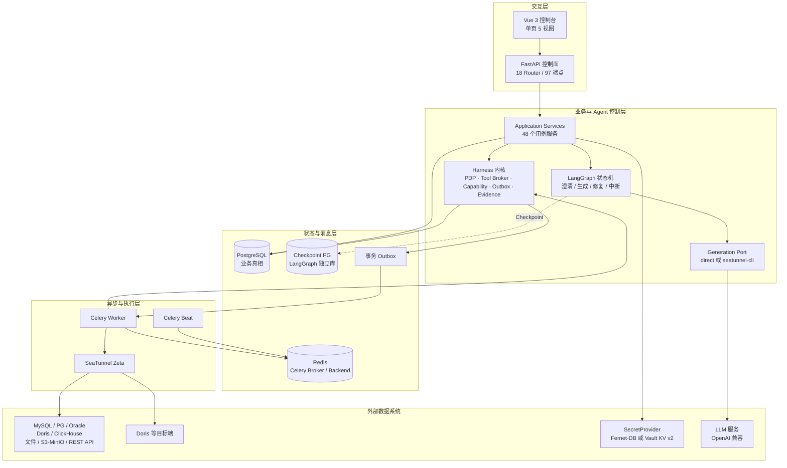
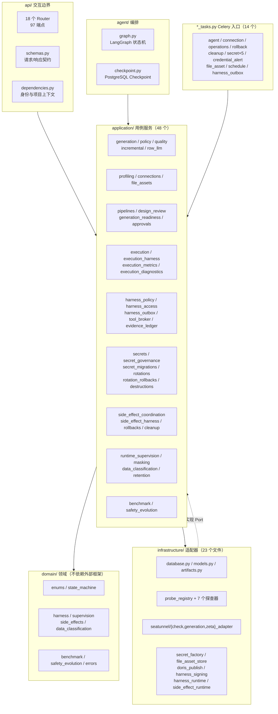
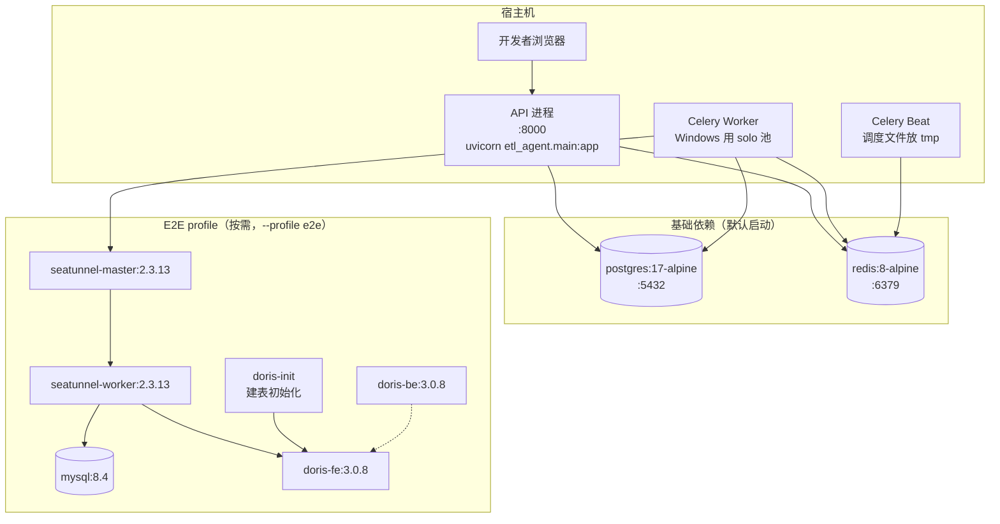
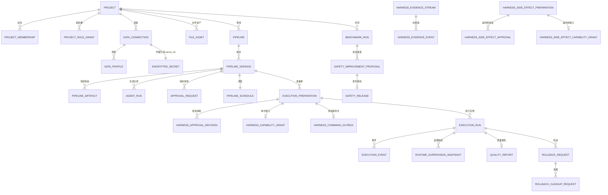
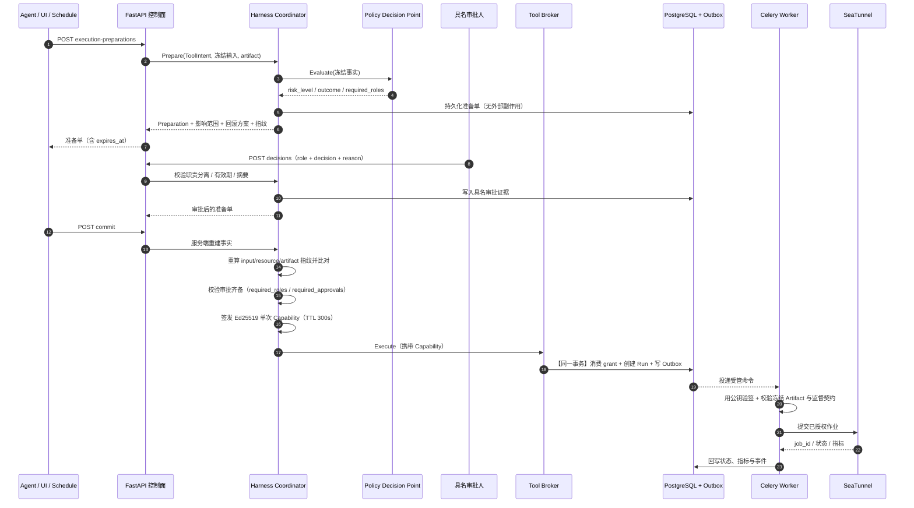
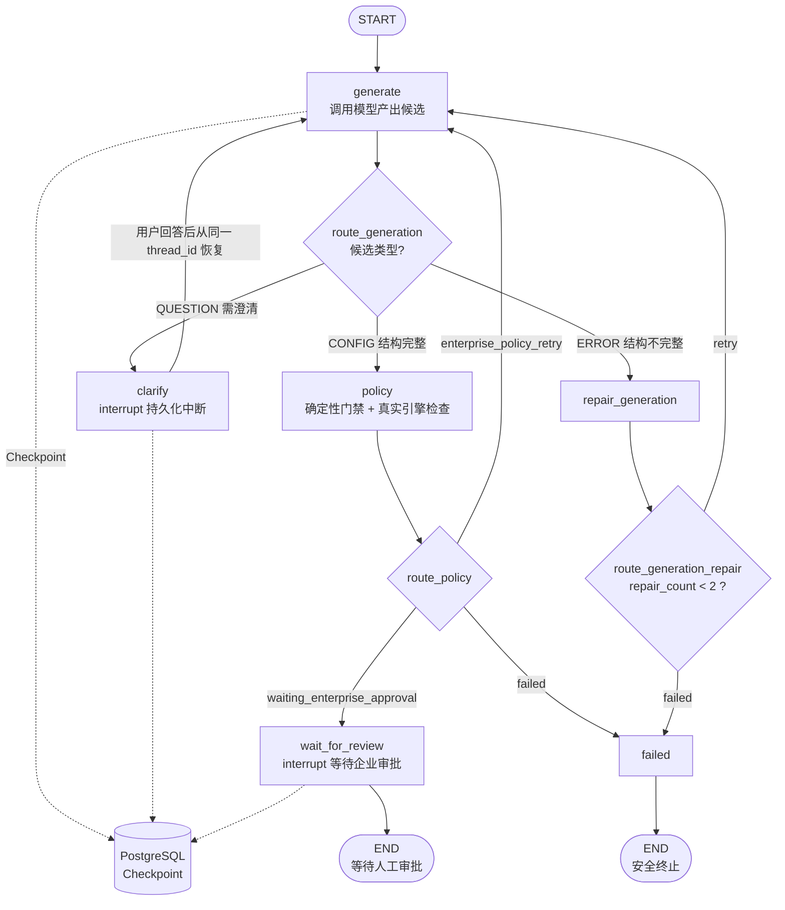
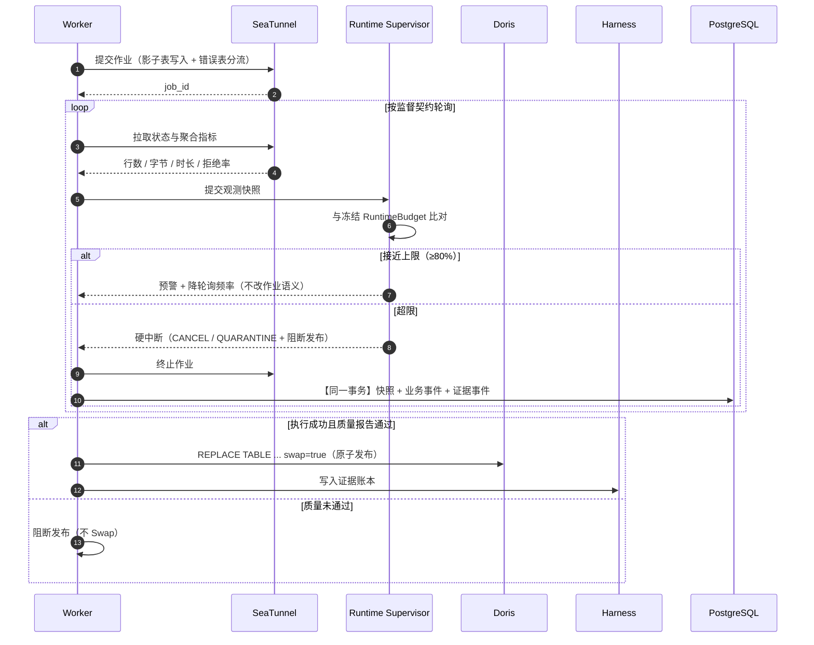

# 生产级 ETL-Agent 数据集成平台 技术设计规格说明书（Design Spec）

> | 项 | 内容 |
> |----|------|
> | 文档名称 | 技术设计规格说明书（Design Spec） |
> | 版本 | v1.1 |
> | 架构师角色 | 系统架构师 |
> | 日期 | 2026-10-16 |
> | 状态 | 评审稿（**D-Q1~D-Q7 已决策，无未决设计事项**） |
> | 依据 PRD | 《生产级 ETL-Agent 数据集成平台 需求规格说明书》**v1.2**（`specs/PRD.md`，无未决问题） |
> | 参考实现 | 课程官方参考代码 `etl_agent`（用于核实技术事实；**设计以 PRD 为准**） |
> | 修订说明 | v1.1 完成 D-Q1~D-Q7 全部决策并回写章节：新数据源探查边界入 §8.2（ClickHouse 四项口径 / REST 支持鉴权头 / S3 前缀采样严禁全量下载）、错误码六段转为预留契约（§6.4）、ADR-08 确认本期不拆、新增 **T-63** 新数据源攻击面场景（14 → 20），§11 由「待明确」转为「决策记录」 |

> **设计口径说明**：本文档承接 PRD v1.2。凡 PRD 已量化的指标，本文档只补充「如何实现」的手段，不复述指标；凡 PRD 判定为实现缺口（GAP-01~03：ClickHouse / S3-MinIO / REST API）的，本文档给出接入点与扩展方式，并在 §10 单列任务。

---

## 1. 架构设计概述

### 1.1 架构风格

**控制面 / 数据面分离 + 分层架构 + 确定性安全内核（Agent Harness）**

不是微服务架构。这是一个**单控制面进程 + 独立异步 Worker** 的模块化单体，理由见 ADR-01。



**责任停止点（三类关键方向，缺一不可）**

| 方向 | 规则 |
|------|------|
| 候选 → 授权 | LangGraph **只能**把候选意图交给 Harness，**不能**直达 SeaTunnel |
| 命令 → 执行 | Worker **只接受** Harness 产生的经签名命令；不接受其他来源的作业提交 |
| 状态 → 真相 | 浏览器只保存工作区与操作者选择；企业状态一律回 PostgreSQL，刷新后重新拉取 |

### 1.2 选型理由与权衡

**为什么是「模块化单体 + 独立 Worker」而不是微服务**

| 维度 | 模块化单体（选定） | 微服务 |
|------|------------------|--------|
| 事务边界 | Harness 的「Consume Capability + 创建 Run + 写 Outbox」可在**单个本地事务**内原子完成 | 跨服务需 Saga/2PC，原子性保障成本剧增 |
| 部署复杂度 | 单进程 + Worker，Compose 起 postgres/redis 即可 | 需服务发现、网关、配置中心 |
| 故障定位 | 一条 Trace 串完全链路 | 跨服务调用链需额外基建 |
| 扩展性 | 控制面状态在 PostgreSQL，可水平扩副本 | 天然可分片 |
| **放弃什么** | 放弃了「按域独立部署与独立扩缩容」 | —— |

**关键判断**：本项目的安全性**依赖本地事务原子性**（PRD FR-47 事务 Outbox）。微服务会直接破坏这条不变量 —— 把「同一事务」变成「跨服务最终一致」，安全强度下降。因此**为了安全选单体**，这是有意识的权衡，不是省事。

**为什么安全裁决必须移出模型**：模型不可靠是既定前提。`ToolIntent`、PDP、Capability、Replay Guard、Outbox、Evidence 全部是**确定性代码 + 数据库约束**，模型无法通过 Prompt 绕过（PRD FR-50 失败关闭）。

**为什么用 LangGraph 而不是自己写状态机**：需要的是**可持久化中断与恢复**（PRD FR-26/FR-27）。LangGraph 提供 `interrupt()` + PostgreSQL Checkpoint 的原生能力，自研需要处理序列化、版本兼容与并发恢复。**但** LangGraph 不提供企业授权语义 —— 资源范围、风险规则、职责审批、能力声明、证据协议全部自研（见 ADR-06）。

**为什么三阶段协议而不是单请求授权**：见 ADR-02。

---

## 2. 技术栈与依赖

### 2.1 技术栈

| 层 | 技术选型 | 版本约束 | 用途 |
|----|---------|---------|------|
| 前端 | Vue 3 + TypeScript + Vite | — | 单页控制台（5 视图） |
| 后端 | Python | **3.12.x**（不含 3.13） | 控制面服务 |
| Web 框架 | FastAPI + Uvicorn | fastapi ≥0.116 | 97 个 REST 端点 |
| 异步任务 | Celery[redis] | ≥5.5 | 14 个任务模块，Worker + Beat |
| Agent 编排 | LangGraph + langgraph-checkpoint-postgres | langgraph ≥0.6 | 生成状态机 + 可恢复中断 |
| ORM / 迁移 | SQLAlchemy[asyncio] + Alembic | ≥2.0.41 | 41 张表 |
| 主存储 | PostgreSQL | 17-alpine | 业务真相 + Checkpoint（**两个独立库**） |
| 消息/缓存 | Redis | 8-alpine | Celery Broker / Backend |
| 数据面引擎 | Apache SeaTunnel Zeta（REST） | flowpilot/seatunnel:2.3.13 | 数据搬运 |
| 目标端 | Apache Doris | fe/be 3.0.8 | 影子表 + 原子 Swap |
| 签名 | cryptography（Ed25519） | ≥50 | Capability / 策略包 / 证据签名 |
| 校验 | Pydantic + pydantic-settings | v2 + ≥2.10 | 契约与配置强校验 |
| 可观测 | OpenTelemetry（OTLP/HTTP） | ≥1.37 | Trace 串联（默认关闭） |
| 结构化日志 | structlog | ≥25 | 低敏结构化日志 |
| 调度表达式 | croniter | ≥6 | 定时触发 |

### 2.2 异构数据源驱动（实测依赖）

| 依赖 | 覆盖数据源 |
|------|-----------|
| pymysql | MySQL、Doris（MySQL 协议） |
| asyncpg | PostgreSQL |
| oracledb | Oracle |
| python-tds | SQL Server |
| pyhive + pure-sasl + thrift + thrift-sasl | Hive |
| （HDFS 探查） | HDFS |
| openpyxl | Excel |
| pypdf | PDF |
| pyarrow | Parquet |
| pyorc | ORC |
| defusedxml | XML（**安全解析**，防 XXE） |

### 2.3 本次需新增的依赖（对应 GAP-01~03）

| 缺口 | 建议依赖 | 说明 |
|------|---------|------|
| GAP-01 ClickHouse | `clickhouse-connect` 或 `asynch` | 探查走 `system.columns` 等系统表，**不执行无界全表 COUNT** |
| GAP-02 S3/MinIO | `aioboto3` 或 `minio` | 对象枚举 + **前缀范围采样（Range GET，默认 8 MiB，严禁全量下载）**；凭据同样入 SecretProvider |
| GAP-03 REST API | `httpx`（**已有**） | 复用现有依赖，需补出口主机白名单校验 |

> **依赖选择原则**：探查器是「Port 的实现」，新增数据源**只新增 Adapter + 注册表条目**，不改领域层与应用层（见 §3 依赖方向）。

### 2.4 既定依赖 vs 本次引入

| 类别 | 内容 |
|------|------|
| 团队既定（PRD §10.3 约束） | Python 3.12、FastAPI、LangGraph、Celery、PostgreSQL、Redis、SeaTunnel Zeta、Vue 3、Ed25519 |
| 本次引入 | ClickHouse / S3-MinIO 客户端（GAP-01/02）、REST API 采集（复用 httpx） |

---

## 3. 模块 / 服务划分

### 3.1 模块拓扑



**依赖方向铁律**：`api / *_tasks → application → domain ← infrastructure`。**domain 层不导入** FastAPI、Celery、SQLAlchemy、任何数据库驱动。这条保证了业务规则可以脱离框架测试。

### 3.2 模块职责边界

| 模块 | 做什么 | **明确不做什么** |
|------|--------|-----------------|
| `api/` | 请求校验、身份与项目上下文注入、领域异常→HTTP 映射、响应组装 | 不写业务规则；不直接访问数据库做跨表业务判断；不决定审批是否通过 |
| `agent/` | LangGraph 状态机编排、澄清中断、Checkpoint 持久化与恢复 | **不持有**数据库 Session；**不持有**引擎凭据；不直接提交 SeaTunnel |
| `application/` | 用例编排、端口（Port）定义、事务边界、确定性门禁、Harness 协调 | 不实现具体数据库/引擎协议；不含 SQL 方言细节 |
| `infrastructure/` | 实现 Port：数据库、7 个探查器、SeaTunnel Adapter、Secret Provider、签名、文件存储 | 不含业务决策；不做权限判断 |
| `domain/` | 枚举、显式状态机、Harness 值对象、监督契约、副作用集合 | **不依赖任何框架**；不做 I/O |
| `*_tasks.py` | Celery 任务入口、外部调用隔离、重试语义 | 不做业务规则；不绕过 Harness 执行副作用 |
| `config.py` | 供应商中立配置、生产边界启动期校验 | 不做运行时动态改配 |
| `worker.py` | Celery 配置、4 个 Beat 定时任务、可观测埋点 | 不含业务逻辑 |
| `main.py` | FastAPI 装配、路由挂载、异常处理器、埋点 | 不含业务逻辑 |

**职责重叠排查**：权限判断**只在** `application/harness_policy.py` + `domain/harness.py`；状态流转**只在** `domain/state_machine.py`；外部副作用**只在** `infrastructure/` 各 Adapter，且必须经 Tool Broker。三者不重复。

### 3.3 PRD 功能覆盖对照

| PRD 功能域 | 承载模块 |
|-----------|---------|
| FR-01~06 身份与项目治理 | `api/routes/{projects,health}` + `application/project_members` + `domain/harness::HarnessRole` |
| FR-07~15、FR-103 连接与探查 | `application/{connections,profiling,file_assets}` + `infrastructure/probe_registry` + 7 探查器 |
| FR-16~23 凭据治理 | `application/{secrets,secret_governance,secret_migrations,secret_rotations,secret_rotation_rollbacks,secret_destructions,credential_*}` + `secret_destruction_tasks` 等 |
| FR-24~33 智能生成 | `agent/graph` + `application/{generation,generation_readiness,policy,quality,incremental,row_llm,design_review}` |
| FR-34~40 门禁与版本 | `application/{pipelines,schema_contract}` + `domain/state_machine` + `infrastructure/artifacts` |
| FR-41~50 Harness 内核 | `application/{harness_policy,harness_access,harness_outbox,tool_broker,evidence_ledger}` + `infrastructure/{harness_signing,harness_runtime}` |
| FR-51~57 三阶段协议 | `application/{execution_harness,approvals,side_effect_coordination}` |
| FR-58~67 执行与调度 | `application/{execution,execution_metrics,delivery,schedules}` + `infrastructure/seatunnel/*` + `worker.py` |
| FR-68~74 质量与发布回滚 | `application/{quality,rollbacks,cleanup}` + `infrastructure/doris_publish` |
| FR-75~82 运行监督诊断 | `application/runtime_supervision` + `domain/supervision` + `application/execution_diagnostics` |
| FR-83~91 评测与安全进化 | `application/{benchmark,safety_evolution}` + `domain/{benchmark,safety_evolution}` + `benchmark_cli` |
| FR-92~98 控制台 | `frontend/src/App.vue` + `api.ts` + `types.ts` |
| FR-99~102 可观测 | `observability.py` + `domain/errors` + `application/retention` |

---

## 4. 部署拓扑

### 4.1 本地 / 演示环境（Compose）



**两个数据库不能合并**：`postgres` 承载业务真相（含 41 张表），`etl_checkpoint` 是 LangGraph Checkpoint 独立库，由 `infra/postgres-init.sql` 在数据卷首次创建时建库。**Checkpoint 不代替审批、授权与执行台账**。

### 4.2 环境差异

| 环境 | 启动方式 | 镜像来源 | 说明 |
|------|---------|---------|------|
| **dev（本地最小）** | `docker compose up -d postgres redis` | 基础离线镜像（≈155 MB） | 只跑控制面 + 迁移，不做真实搬运 |
| **dev（E2E）** | `docker compose --profile e2e up -d --no-build --pull never` | 基础 + E2E 扩展镜像（≈7.6 GB） | 跑 L2 真实链路与 Benchmark L2 |
| **test / CI** | 同上（e2e profile）+ 单元测试 | 同上 | L0/L1 仿真不依赖外部服务 |
| **staging / prod** | **不在本期交付范围** | — | 见 §4.3 |

**离线镜像使用约束（PRD ENV-01~07 落地）**

1. 离线镜像**只替代镜像下载**，不替代运行时、Compose、数据卷初始化与迁移 → Alembic 迁移与 Checkpoint 建库**必须执行**
2. 起服务必须带 `--no-build --pull never`，不允许在线拉取或构建
3. `e2e` profile 下才有 mysql / doris / seatunnel，不带 profile 不会创建
4. SeaTunnel master 与 worker **复用同一镜像**
5. 多个数据库**不塞进一个容器**（不减内存，反而耦合健康检查、数据卷、故障域与许可）

### 4.3 生产部署差距（明确不做，避免误判）

本期**不交付**生产部署形态。生产需补齐：PostgreSQL / Redis / SeaTunnel 高可用与备份灾备、企业 SSO/IAM 与可信网关、TLS 与网络隔离、WAF 与速率限制、外部 KMS、WORM 证据存储、值班与事故响应制度。

**但生产必需的软件边界已在设计中预留**：`auth_mode` 生产强制 `trusted-gateway`、Worker 只挂公钥、私钥/公钥分离、Bootstrap 一次性短时开启（见 §8.1）。

---

## 5. 数据模型（ER）

### 5.1 核心实体关系



### 5.2 表清单（实测：41 张表，41 个模型类，一一对应）

| 分组 | 表 | 列数 |
|------|----|------|
| 身份与项目治理 | `users` / `projects` / `project_memberships` / `project_role_grants` | 3 / 2 / 4 / 5 |
| 连接与资产 | `data_connections` / `data_profiles` / `file_assets` | 17 / 14 / 18 |
| 凭据治理 | `encrypted_secrets` / `secret_migration_requests` / `secret_rotation_requests` / `secret_rotation_rollback_requests` / `secret_destruction_requests` | 6 / 13 / 18 / 12 / 13 |
| 凭据告警 | `credential_expiry_alerts` / `credential_alert_deliveries` | 19 / 9 |
| Pipeline 与版本 | `pipelines` / `pipeline_versions` / `pipeline_artifacts` | 3 / 10 / 6 |
| 生成与调度 | `agent_runs` / `pipeline_schedules` | 22 / 19 |
| 版本审批 | `approval_requests` | 8 |
| Harness 安全内核 | `harness_policy_decisions` / `execution_preparations` / `harness_approval_decisions` / `harness_capability_grants` / `harness_command_outbox` / `harness_evidence_streams` / `harness_evidence_events` | 14 / 26 / 8 / 13 / 11 / 6 / 16 |
| 通用副作用 | `harness_side_effect_preparations` / `harness_side_effect_approvals` / `harness_side_effect_capability_grants` | 34 / 8 / 12 |
| 执行与监督 | `execution_runs` / `execution_events` / `runtime_supervision_snapshots` / `worker_heartbeats` | 35 / 8 / 18 / 6 |
| 质量与回滚 | `quality_reports` / `rollback_requests` / `rollback_cleanup_requests` | 12 / 12 / 14 |
| 审计 | `audit_events` | 11 |
| 评测与安全进化 | `benchmark_runs` / `safety_improvement_proposals` / `safety_releases` | 14 / 16 / 25 |

### 5.3 关键表字段（细化到可建表）

**`pipeline_versions`** — 不可变版本

| 列 | 类型 | 约束 |
|----|------|------|
| `id` | UUID | PK |
| `pipeline_id` | UUID | 归属管线 |
| `version_number` | int | 版本号，修改需求产生 V+1 |
| `status` | enum(str) | `PipelineVersionStatus` 7 态 |
| `requirement` | text | 本次需求原文（可回溯） |
| `parent_version_id` | UUID? | 父版本，支持版本谱系 |
| `plan` | JSON | 结构化 EtlPlan |
| `artifact_sha256` | str? | **冻结摘要**，审批绑定此值 |
| `lock_version` | int | 乐观锁 |
| `created_by` | UUID | FK |

**`agent_runs`** — 一次生成的可观测事实

关键列：`thread_id`（Checkpoint 恢复用）、`status`（5 态）、`profile_ids`、`quality_contract`、`incremental_contract`、`row_llm_contract`、`pending_question`（澄清中断）、`generation_backend`、`generation_model`、`generation_provider_calls`、**`generation_candidates`**、**`generation_repairs`**（对应 PRD FR-31 的 3 份候选预算，可验收）、`generation_elapsed_ms`、`generation_phase`、`generation_diagnostics`。

**`execution_preparations`** — 准备单（26 列）

| 列 | 说明 |
|----|------|
| `id` | PK |
| `policy_decision_id` | 关联 PDP 决策 |
| `status` | `ExecutionPreparationStatus` 6 态：DENIED / WAITING_APPROVAL / READY / REJECTED / EXPIRED / COMMITTED |
| `risk_level` | P0~P3 |
| `policy_bundle_version` | 策略包版本（可追溯） |
| `environment` | 环境（防跨环境重放） |
| `tool_name` / `tool_version` | 工具契约版本 |
| **`artifact_sha256`** | 制品摘要（审批绑定对象） |
| **`input_fingerprint`** | 输入指纹（Commit 时重算比对） |
| **`resource_fingerprint`** | 资源指纹 |
| `impact_report` / `rollback_plan` | 影响范围与回滚方案（JSON） |
| `required_roles` / `required_approvals` | 职责槽与人数要求 |
| `idempotency_key` | 幂等键 |
| `expires_at` | 有效期（默认 24h） |
| `committed_by` / `committed_at` | 提交人与时间 |
| `lock_version` | 乐观锁 |

**`harness_capability_grants`** — 单次能力令牌

| 列 | 说明 |
|----|------|
| `token_id` | PK |
| `preparation_id` | 来源准备单 |
| `token_sha256` | **unique**，防重复签发 |
| `key_id` | 签名密钥标识 |
| `claims` | 声明体（JSON） |
| `claims_signature_algorithm` / `claims_signature_value` | Ed25519 分离签名 |
| `subject_id` | 绑定主体 |
| `issued_at` / `expires_at` | **默认 300 秒** |
| `consumed_at` / `consumed_by` | **消费即置位 → 第二次使用必失败**（Replay Guard） |
| `execution_run_id` | 消费后关联的执行实例 |

**`execution_runs`** — 执行实例（35 列，最宽表）

分组说明：身份与版本（`pipeline_version_id`、`harness_preparation_id`）、状态机（`status` 7 态、`engine_status`）、幂等（`idempotency_key` **unique**）、引擎（`seatunnel_job_id`）、时间线（`submitted_at` / `started_at` / `finished_at` / `last_observed_at`）、重试（`retry_of_run_id` / `attempt_number`）、取消（`cancel_requested_at` / `cancel_reason`）、指标（`source_rows` / `sink_rows` / `source_bytes` / `sink_bytes` / `table_metrics`）、诊断（`failure_category` / `failure_stage` / `retryable` / `diagnosis`）、监督（`supervision_action` / `supervision_contract_sha256` / `quarantined_at` / `quarantine_reason`）、调度（`trigger` / `schedule_id` / `scheduled_for` / `watermark_window`）。

**`harness_evidence_events`** — 哈希链

| 列 | 说明 |
|----|------|
| `stream_id` / `sequence` | 流内有序 |
| `event_type` / `risk_level` | 事件类型与风险 |
| `payload` / `payload_sha256` | 载荷与其摘要 |
| **`previous_hash` / `event_hash`** | **链式前序哈希**，改写即断链 |
| `signature_algorithm` / `signature_key_id` / `signature_value` | 签名检查点 |
| `trace_id` | 与 Trace 关联 |

**`data_profiles`** — 受管元数据事实（有**时效**）

`connection_id`、`schema_name`、`table_name`、`endpoint_role`（SOURCE/SINK）、`status`、`schema_json`、`primary_keys`、`statistics`（近似统计）、**`masked_sample`**（脱敏样本，原文不落盘）、`sample_size`、**`expires_at`**、`error`。

### 5.4 枚举与约束落地

| 落地方式 | 说明 |
|---------|------|
| 枚举存储 | 一律**非原生字符串枚举**（`Enum(..., native_enum=False)`），避免 PostgreSQL 原生枚举升级/回滚困难 |
| 状态机 | 三张显式迁移表（版本 / 执行 / AgentRun），非法跃迁抛 `InvalidStateTransition` |
| 幂等 | `idempotency_key` unique 约束 + Capability `token_sha256` unique |
| 乐观锁 | `lock_version` 用于版本、准备单、调度 |
| 时间 | 统一 UTC 存储与序列化 |

---

## 6. 关键接口定义

### 6.1 接口总览（实测 97 端点 / 18 组）

| 组 | 端点数 | 核心职责 |
|----|-------|---------|
| `pipelines` | 8 | 管线创建、版本、设计审查视图、profiling / generation / validation / revisions |
| `executions` | 13 | 执行查询、事件、监督快照、质量报告、取消、重试准备、**Prepare/Commit** |
| `safety_evolution` | 14 | Benchmark 运行、改进提案、影子/Canary/推广/回滚 |
| `operations` | 9 | Worker 健康、回滚制品盘点、凭据治理盘点、到期告警与扫描 |
| `connections` | 8 | 连接 CRUD、凭据轮换策略、连通性测试、Profile 探查 |
| `projects` | 4 | Bootstrap、成员、Harness 职责槽授予 |
| `agent_runs` | 4 | 发起生成、回答问题、查询生成记录 |
| `rollbacks` / `cleanups` | 4 / 4 | 回滚与清理申请、决策 |
| `secret_rotations` / `_rollbacks` / `migrations` / `destructions` | 4×4 | 凭据轮换、回退、迁移、销毁 |
| `schedules` | 3 | 调度配置与启停 |
| `file_assets` | 3 | 文件资产上传与查询 |
| `side_effects` | 3 | 通用副作用准备单与审批查询 |
| `health` | 1 | 健康检查 |

### 6.2 核心 API 契约（8 个）

**API-01 创建管线版本** `POST /api/v1/pipelines`

| 项 | 内容 |
|----|------|
| 入参 | `project_id`(UUID)、`name`(1-255)、`requirement`(1-20000) |
| 出参 | `PipelineVersionResponse`：`id`、`pipeline_id`、`version_number`、`status`、`requirement`、`parent_version_id`、`artifact_sha256`、`lock_version` |
| 错误 | 403 无项目权限；404 项目不存在；400 参数非法 |

**API-02 发起生成** `POST /api/v1/pipeline-versions/{version_id}/agent-runs`

| 项 | 内容 |
|----|------|
| 入参 | `profile_ids`(1-20)、`quality_contract?`、`incremental_contract?`、`row_llm_contract?` |
| 出参 | `AgentRunResponse`（含 `thread_id`、`status`、`pending_question`、`generation_candidates`、`generation_repairs`） |
| 语义 | `status=WAITING_INPUT` 表示需要澄清 → 用 **API-03** 补充 |

**API-03 回答澄清** `POST /api/v1/agent-runs/{run_id}/answers`

| 项 | 内容 |
|----|------|
| 入参 | `answer`(1-20000) |
| 出参 | `AgentRunResponse` |
| 语义 | 从**同一 `thread_id`** 恢复，不重跑（PRD FR-27） |

**API-04 查看设计审查视图** `GET /api/v1/pipelines/versions/{version_id}/design`

| 项 | 内容 |
|----|------|
| 出参 | `PipelineDesignResponse`：`pipeline_version_id`、`status`、**`artifact_sha256`**、`plan`(EtlPlan)、`hocon`（**不含明文凭据**） |
| 语义 | 审批人看到的就是将要执行的内容（PRD US-13） |

**API-05 Prepare 生成准备单** `POST /api/v1/pipeline-versions/{version_id}/execution-preparations`

| 项 | 内容 |
|----|------|
| 入参 | `idempotency_key`(8-128)，**其余事实由服务端冻结** |
| 出参 | `ExecutionPreparationResponse`：`status`、`risk_level`、`artifact_sha256`、`input_fingerprint`、`resource_fingerprint`、`impact_report`、`rollback_plan`、`required_roles`、`required_approvals`、`expires_at` |
| 语义 | **不产生任何外部副作用**（PRD FR-51） |

**API-06 职责审批** `POST /api/v1/execution-preparations/{preparation_id}/decisions`

| 项 | 内容 |
|----|------|
| 入参 | `role`(HarnessRole)、`decision`(APPROVE/REJECT)、`reason`(1-2000) |
| 出参 | `ExecutionPreparationResponse` |
| 错误 | 403 **申请人自批 / 一人占多槽**（SOD-01~03）；409 准备单状态已变或摘要不匹配 |

**API-07 Commit 提交执行** `POST /api/v1/execution-preparations/{preparation_id}/commit`

| 项 | 内容 |
|----|------|
| 入参 | 无（**服务端从业务真相重建事实**） |
| 出参 | `ExecutionRunResponse` |
| 语义 | 重算指纹 → 校验审批 → 签发单次 Capability → **同一事务**创建 Run 与 Outbox |
| 错误 | 409 准备单过期或审批未齐；400 指纹不一致 |

**API-08 执行查询** `GET /api/v1/execution-runs/{run_id}`

| 项 | 内容 |
|----|------|
| 出参 | `ExecutionRunResponse`（35 列投影：状态、指标、`failure_category`/`failure_stage`/`diagnosis`、`supervision_action`、`quarantined_at`） |
| 语义 | 只返回脱敏聚合指标，不含原始业务行与凭据 |

### 6.3 OpenAPI 片段示例

```yaml
/api/v1/execution-preparations/{preparation_id}/decisions:
  post:
    summary: 提交具名职责审批决定
    parameters:
      - name: preparation_id
        in: path
        required: true
        schema: { type: string, format: uuid }
    requestBody:
      required: true
      content:
        application/json:
          schema:
            type: object
            required: [role, decision, reason]
            properties:
              role:
                type: string
                enum: [DATA_ENGINEER, DATA_APPROVER, SECURITY_APPROVER, OPERATOR, AUDITOR]
              decision:
                type: string
                enum: [APPROVE, REJECT]
              reason:
                type: string
                minLength: 1
                maxLength: 2000
    responses:
      '200':
        description: 返回更新后的准备单（含最新审批事实）
        content:
          application/json:
            schema: { $ref: '#/components/schemas/ExecutionPreparationResponse' }
      '400': { description: '领域校验失败（如准备单已过期）' }
      '403': { description: '职责分离违规：申请人自批或一人占多槽（SOD-01~03）' }
      '404': { description: '准备单不存在' }
      '409': { description: '状态冲突：用乐观锁 lock_version 拒绝并发覆盖' }
```

### 6.4 错误处理与错误码体系

**实测机制**：领域异常类 → HTTP 状态码集中映射，响应体统一为 `{ "detail": "...", "trace_id": "..." }`。

| 领域异常 | HTTP | 语义 |
|---------|------|------|
| `DomainError`（基类） | **400** | 可安全转换为 4xx 的业务规则违反 |
| `InvalidStateTransition` | 400 | 状态机拒绝跳步 / 非法回退 / 终态重启 |
| `PermissionDenied` | **403** | 权限与职责分离违规 |
| `ResourceNotFound` | **404** | 资源不存在 |
| `VersionConflict` | **409** | 乐观锁冲突、摘要不匹配、幂等冲突 |
| `ExternalServiceUnavailable` | **503** | 外部依赖暂不可用；异步任务可按**有限次数**安全重试 |
| 未捕获异常 | 500 | 不向客户端泄露内部细节 |

**设计取向说明（决策 D-Q4）**：本期**不引入字符串业务错误码段位**（如 `BIZ_xxx`）。理由：现有机制用**异常类型 + HTTP 状态码 + trace_id** 已能支撑前端分流与排障，`trace_id` 提供到日志的精确跳转；引入段位需改动 97 个端点的响应契约与前端分流逻辑，而收益只在对接**外部系统**时才兑现，本期无该需求。

**预留扩展契约（不实现，仅登记）**：若后续需对外暴露稳定错误码，按六段划分 ——

| 段位 | 覆盖范围 |
|------|---------|
| `AUTH_` | 身份、网关签名、职责分离违规 |
| `HAR_` | Harness 内核：策略、Capability、重放、Outbox、证据 |
| `PIPE_` | Pipeline 与版本、生成门禁、调度 |
| `EXEC_` | 执行、引擎对接、取消、重试 |
| `SEC_` | 凭据、Secret 生命周期、数据分级 |
| `BENCH_` | Benchmark 与安全进化 |

扩展时须保持 HTTP 状态码语义不变（错误码是**附加**字段，不替代状态码）。

---

## 7. 关键流程时序图

### 7.1 `prepare → approve → commit` 全链路（主流程）



**关键不变量**：Commit 之前**外部系统零副作用**；Capability 消费、Run 创建、Outbox 写入在**同一事务**；Worker 在**读 Secret 与接触引擎之前**必须验签。

### 7.2 LangGraph 生成状态机（含中断恢复与 3 份候选预算）



**3 份候选预算的共享机制（PRD FR-31 落地）**：`repair_count` 由**三类失败共同递增** —— ①候选完整性失败（`repair_generation`）②确定性门禁失败（`policy` 捕获 `DomainError`）③真实引擎 `--check` 未通过（同上）。上限 `MAX_ENTERPRISE_REPAIR_ATTEMPTS = 2`，即**首次 1 份 + 最多 2 次修复 = 总量 3 份**。

> **设计要点**：真实引擎检查**必须在人工审批中断之前**完成 —— 否则错误候选会先占用人工时间，且已用掉的候选预算无法回收。这是「先机器、后人工」的顺序约束。

### 7.3 执行与运行监督



---

## 8. 非功能设计

### 8.1 安全设计

| PRD 指标 | 设计手段 |
|---------|---------|
| 敏感明文泄露 = 0 | ①`SecretStr` 全链路包裹凭据，避免意外回显；②Secret 只在 Worker **单次运行作用域**物化；③API 响应不含 `secret_ref` 以外内容；④审计只存摘要；⑤`require_no_hardcoded_secrets()` 门禁拒绝 HOCON 内联明文；⑥`row_llm_api_path` 出口白名单 |
| 生产身份来自可信网关 | `auth_mode` 启动期校验：`environment ∈ {prod, production}` 时**强制** `trusted-gateway`；HMAC 共享密钥 **≥32 字节**；时钟偏差 ≤300s |
| 私钥 / 公钥分离 | API 与授权服务**持有私钥**；Worker **只挂公钥映射**（`harness_public_keys`），Worker 无法自行签发 |
| Capability 短时单次 | Ed25519 分离签名；TTL 300s；`single_use=true`；绑定工具 + 主体 + 环境 + 输入/资源/Artifact 指纹 + 监督契约摘要 |
| 防重放 | `harness_capability_grants.consumed_at` 在**同一事务**内置位；`token_sha256` unique；跨环境使用因 `environment` 声明不匹配而失败 |
| 跨项目访问 = P0 阻断 | PDP 按 `ResourceScope.project_id` 与请求主体项目比对，不一致直接 DENY |
| 数据分级保守失败 | 分类缺失记 `UNKNOWN`，按保守等级参与策略判断；分类报告摘要写入 Capability 声明 |
| 证据不可篡改 | `previous_hash → event_hash` 链式；流内 `sequence` 有序；签名检查点；删除/插入/改写/伪造检查点均可被发现 |
| 失败关闭分级 | 策略、审批、签名、证据、Secret 任一无法验证 → 写/删/外发/密钥使用**不放行** |
| 职责分离 | 项目角色（`ProjectRole`）管资源可见性；Harness 职责槽（`HarnessRole`）管审批与授权；两套分离，申请人自批与一人多槽在 Approve 阶段拦截 |

**明确的安全边界（不承诺）**：签名哈希链可发现**平台数据库内**证据被改写，但不是外部公证系统；若攻击者同时控制数据库与私钥，仍需 KMS + WORM 存储。

### 8.2 性能设计

| PRD 指标 | 设计手段 |
|---------|---------|
| Harness 非 LLM P95 基线 20ms，回归 ≤20% | ①确定性路径**不调用模型**；②PDP 纯计算 + 策略包清单内存比对；③指纹计算用规范 JSON 序列化（`sort_keys`）保证稳定且可缓存；④Capability 校验为本地验签，无网络往返 |
| 控制面不阻塞 | 所有外部调用（探查、生成、引擎提交）**全部经 Celery** 异步；API 只做校验、事务与编排 |
| 单次运行预算硬上限 | `RuntimeBudget` 冻结 6 项上限（1000 万行 / 10 GiB / 3600s / 放大比 2.0 / 拒绝率 50% / 最小质量行数 100），**作业开始后不得扩权** |
| 轮询开销可控 | 监督轮询间隔默认 2s；接近上限（≥80%）时**只降频**，不改作业语义 |
| 大表探查不拖垮源库 | 探查**禁止无界全表 COUNT**；只取元数据系统表 + 限量样本（`sample_limit` 默认 20，上限 100） |
| 文件资产边界 | 单文件 ≤25 MiB、≤10 万行，超限拒绝 |
| 新数据源探查边界（决策 **D-Q1~D-Q3**） | ①**ClickHouse**：只走系统表取基线四项（Schema / 类型 / 近似统计 / 脱敏样本），不取压缩编码、TTL、分区键等展示型元数据；②**REST API**：单次采样 + 结构推断，支持请求头鉴权（凭据走 Secret 引用），不做分页与嵌套展平；③**S3/MinIO**：只取对象元数据 + **前缀范围采样（默认前 8 MiB）**，**严禁全量下载** —— 对象可达 GB 级，全量下载会打爆控制面内存与临时盘，属正确性问题而非性能优化 |

### 8.3 高可用与可靠性设计

| PRD 指标 | 设计手段 |
|---------|---------|
| 不产生「无本地事实的远端作业」 | **事务 Outbox**：`Consume grant + Create Run + Write Outbox` 同一 PostgreSQL 事务；Worker 由 Outbox 扫描任务（2s）可靠投递 |
| 重复消息不产生二次副作用 | `idempotency_key` unique + Capability 单次消费 + 载荷摘要校验 + 副作用执行租约（`SideEffectLeaseBusy`，冲突时安全延迟重试而非记失败） |
| Worker 失联可检出 | 心跳 10s 上报 / 35s 判定失联（`worker_heartbeats`） |
| 引擎状态未知先对账 | 状态推进**以外部事实为准**；远端已接受但本地响应丢失时，按 `seatunnel_job_id` 对账，不重复提交 |
| 取消语义诚实 | 取消请求成功 ≠ 引擎已停；状态停留在 `CANCELLING` 并持续对账，确认后才进 `CANCELLED` |
| 外部故障不伪装成功 | 引擎不可用 → 已冻结版本与审批事实**保留**，明确报错；模型不可用 → 报告「生成能力未就绪」，不静默失败 |
| 部署高可用 | **本期不交付**（见 §4.3）；但应用侧已满足：控制面无状态可水平扩副本、状态全在 PostgreSQL / Redis |
| 数据迁移可演进 | Alembic 33 个版本文件，按序演进；枚举用非原生存储降低回滚难度 |

### 8.4 可观测性设计

| PRD 指标 | 设计手段 |
|---------|---------|
| API / Agent / Celery / HTTPX / SQLAlchemy 可同 Trace 关联 | OpenTelemetry 自动埋点：`FastAPIInstrumentor`（**路由全部注册后**再挂载，确保覆盖完整 ASGI 应用）+ `CeleryInstrumentor` + `HTTPXClientInstrumentor` + `SQLAlchemyInstrumentor`；API 与 Worker 作为独立进程各自传播同一 Trace |
| 只串联低敏边界 | Span 属性只带低敏字段；**不记录** Prompt、Artifact 内容、凭据、原始行 |
| 审计可查且不成为敏感仓库 | `audit_events` 记录**变化而非秘密**（主体、事件类型、目标对象、变化摘要）；`{detail, trace_id}` 响应便于从错误直达日志 |
| 结构化日志 | structlog；日志不含凭据与原始样本 |
| 监管指标聚合 | 监督快照只含聚合指标（行数/字节/时长/拒绝率/放大比）与规则命中，控制台读取脱敏视图 |
| 告警面 | Worker/Beat 心跳、Outbox 积压、执行失败、凭据到期、Webhook 投递均有对应扫描任务与告警记录 |

---

## 9. 设计决策记录（ADR）

### ADR-01 采用「模块化单体 + 独立 Worker」而非微服务

| 项 | 内容 |
|----|------|
| **背景** | 需要在「控制面可维护」与「安全边界严格」之间取舍 |
| **选项** | A. 微服务（按域拆分）／B. 模块化单体 + 独立异步 Worker／C. 全同步单体 |
| **选择** | **B** |
| **理由** | 安全性依赖**本地事务原子性**（Consume Capability + Create Run + Write Outbox 必须同事务）。微服务把该不变量降级为跨服务最终一致，安全强度下降。全同步单体无法承载长耗时外部调用。B 用「进程内分层 + 独立 Worker」同时保住事务原子性与异步解耦 |
| **后果** | 换来简单部署与强事务；放弃按域独立扩缩容。后续若拆分，**必须先解决 Capability 消费与 Outbox 的原子性**，否则不得拆 |

### ADR-02 采用 `prepare → approve → commit` 三阶段协议，而非单请求授权

| 项 | 内容 |
|----|------|
| **背景** | 单请求流程「校验 → 询问同意 → 立即执行」无法稳定回答：审批期间内容是否变化、策略是否更新、请求是否重放 |
| **选项** | A. 单请求内完成授权与执行／B. 三阶段 + 冻结准备单／C. 两阶段（授权 + 执行） |
| **选择** | **B** |
| **理由** | Prepare 阶段**零外部副作用**且冻结输入/资源/Artifact 指纹，使审批有确定对象；Commit 阶段服务端**重算指纹**，使「审批后替换内容」在结构上不可能；三阶段还天然支持多人职责审批与准备单过期 |
| **后果** | 换来可解释、可审计、抗篡改；代价是流程多两次交互、SQL 多两处状态。C 的两阶段无法表达「多个独立职责槽」 |

### ADR-03 Capability 采用「短时 + 单次 + 绑定指纹」，而非长期令牌或账号级权限

| 项 | 内容 |
|----|------|
| **背景** | 授权必须最小化，且不能因 Worker 被攻破而横向扩权 |
| **选项** | A. 长期 API Token／B. 账号级 RBAC／C. 短时单次能力令牌（Ed25519，绑定工具+主体+环境+指纹） |
| **选择** | **C** |
| **理由** | 长期令牌的泄露窗口过大；账号级权限无法约束「这一次、对这份内容、用这个工具」。C 把授权压缩到**一次操作**：篡改必失败（签名）、过期必失败（300s）、跨环境必失败（environment 声明）、重复用必失败（原子消费） |
| **后果** | 换来极小的授权面与可验证性；代价是每次执行都要走完整 Prepare/Approve/Commit。私钥必须严格隔离（Worker 只持公钥） |

### ADR-04 用「事务 Outbox + Worker 验签」而非控制面直连引擎

| 项 | 内容 |
|----|------|
| **背景** | 控制面直连引擎会出现「远端已接单、本地事务回滚」的事实不一致 |
| **选项** | A. 控制面同步调用引擎／B. 先本地事务后异步投递（Outbox）／C. 直接投递不落库 |
| **选择** | **B** |
| **理由** | B 保证「本地业务事实与待投递命令」**原子落库**：要么都有、要么都无。C 会丢命令；A 会出现无本地事实的远端作业。Worker 再验签一次，使「消息队列被污染」也不足以造成副作用 |
| **后果** | 换来事实一致与可重投；**不提供** PostgreSQL 与外部数据库的跨系统事务（明确不承诺），因此发布阶段用「影子表 + 原子 Swap」而非分布式事务 |

### ADR-05 影子表 + 原子 Swap 发布，错误表独立追加

| 项 | 内容 |
|----|------|
| **背景** | 需要「数据不达标不上线」，且不能中途污染正式表 |
| **选项** | A. 直接写正式表 + 失败后删除／B. 影子表 + 质量门禁 + 原子 Swap／C. 双写 |
| **选择** | **B** |
| **理由** | A 的「删除」可能在失败时留下部分脏数据且不可回滚；C 无法保证一致性。B 让正式表在质量报告通过前**完全不受影响**，`REPLACE TABLE ... swap=true` 一次完成切换 |
| **后果** | 换来零污染与秒级切换；**明确不承诺**有效表与错误表的跨表原子性 —— 错误表按执行追加审计。旧表按受管名称保留（默认 7 天）供回滚 |

### ADR-06 LangGraph 只管编排，企业授权语义全部自研

| 项 | 内容 |
|----|------|
| **背景** | LangGraph 提供状态机与 Checkpoint，但不提供企业执行授权语义 |
| **选项** | A. 把安全规则写进 Prompt／B. 依赖框架自带权限／C. LangGraph 只做编排 + 自研 Harness 内核 |
| **选择** | **C** |
| **理由** | A 完全不构成安全边界（PRD §2.8 明确）；B 不存在 —— 框架不定义「资源范围 / 风险规则 / 职责槽 / 能力声明 / 证据协议」。C 让模型只产出**候选**，确定性代码与数据库约束才是边界 |
| **后果** | 换来不可绕过的边界与可证明性；代价是 Harness 内核（PDP / Broker / Capability / Outbox / Ledger）全部自建。**这也是本项目最核心的技术价值点** |

### ADR-07 数据源探查采用「策略注册表 + 独立 Adapter」，而非 if-else 分支

| 项 | 内容 |
|----|------|
| **背景** | 需要接入 5 种基线数据库 + 3 种超集数据库 + 文件/对象存储/REST API，且后续还会增（GAP-01~03） |
| **选项** | A. 在一个探查函数里 if-else 分支／B. Port + 注册表（每种数据源一个 Adapter）／C. 让模型生成探查 SQL |
| **选择** | **B** |
| **理由** | A 会让单文件膨胀且难测；**C 绝对禁止** —— 探查 SQL 必须由程序生成，否则模型可绕过只读与脱敏约束。B 让新增数据源**只加 Adapter + 注册表一行**，领域层与应用层零改动，且每个 Adapter 可独立测试 |
| **后果** | 换来可扩展与可测试（当前 7 个探查器）；代价是 Port 接口必须足够抽象（已由 `MetadataProbePort` 固定）。实施 GAP-01~03 时按此模式扩展 |

### ADR-08 前端单页集中实现（含技术债登记）

| 项 | 内容 |
|----|------|
| **背景** | PRD §2.8 要求五类页面与六个模块能力，但未约束文件结构 |
| **选项** | A. 单页集中（`App.vue`）／B. 按业务域拆分组件与 composable／C. 多页应用 |
| **选择** | **A（本期）**，并将 B 登记为 P1 技术债 |
| **理由** | 单页降低了教学/演示项目的跳转与状态管理成本，且**满足 PRD 全部页面能力要求**（PRD GAP-08 已判定不构成缺口）。C 与「控制台是控制面的窗口，不是另一套真相源」的定位不符 |
| **后果** | 换来快速交付；代价是 `App.vue` 已达 2086 行，继续扩展可维护性下降。**触发拆分条件**：页面数 >5 或单文件 >3000 行 或 需要前端组件测试。**本期经评审确认不触发**（见 §11 D-Q5）：拆分是纯重构，不新增可讲的技术点，优先级低于补齐数据源与 Benchmark 覆盖 |

---

## 10. 任务分解清单

**编排原则**：按依赖顺序排列；同一阶段内可并行的任务已标注。每个任务标注其交付证据（测试 / 报告）。

### 阶段 0：工程基座（M0）

| 任务 | 模块 | 依赖 | 说明与交付证据 |
|------|------|------|---------------|
| T-01 | 工程骨架 | 无 | uv + Python 3.12 固定；`src` 布局；依赖方向约束（domain 不导入框架与驱动）；ruff + mypy strict 通过 |
| T-02 | 配置边界 | T-01 | `config.py` 供应商中立配置 + 生产边界启动期校验（prod 强制 trusted-gateway、密钥 ≥32B、Bootstrap ≥32B）。**证据**：非法组合启动即失败 |
| T-03 | 基础设施编排 | T-01 | `infra/compose.yaml`（基础 + `e2e` profile）；`postgres-init.sql` 建 Checkpoint 独立库。**证据**：`compose config --quiet` 通过；离线镜像可加载 |
| T-04 | 可观测基座 | T-01 | structlog + OTel 埋点（**路由注册后挂载**）。**证据**：Trace 跨 API/Worker 串联 |

### 阶段 1：领域与身份（M1）

| 任务 | 模块 | 依赖 | 说明与交付证据 |
|------|------|------|---------------|
| T-05 | 领域枚举与状态机 | T-01 | `enums.py` 全量枚举；`state_machine.py` 三张迁移表 + `InvalidStateTransition`。**证据**：单测覆盖跳步/非法回退/终态重启 |
| T-06 | Harness 领域值对象 | T-05 | `harness.py`：`ToolIntent`、`ResourceScope`、`PolicyDecision`、`CapabilityClaims`、`ToolManifest`、`canonical_sha256`（稳定 JSON 序列化）。**证据**：指纹对同输入稳定 |
| T-07 | 数据模型与迁移 | T-05 | 41 张表 + Alembic 33 版本；枚举用非原生字符串。**证据**：`alembic upgrade head` 成功、可回档 |
| T-08 | 身份与项目治理 | T-07 | `bootstrap`（一次性短时）、成员、Harness 职责槽授予；可信网关身份解析。**证据**：生产模式拒绝 dev-header |
| T-09 | 职责分离强制 | T-08 | 申请人自批、一人多槽、执行人与审批人重叠的拦截。**证据**：SOD-01~03 对抗测试 |

### 阶段 2：受管数据上下文（M2）

| 任务 | 模块 | 依赖 | 说明与交付证据 |
|------|------|------|---------------|
| T-10 | Port 与探查契约 | T-06 | `MetadataProbePort`；Profile 时效与状态。**证据**：契约测试 |
| T-11 | 探查器注册表 + 7 个 Adapter | T-10 | MySQL / Doris（复用 MySQL）/ PostgreSQL / Oracle / SQL Server / Hive / HDFS。**证据**：各 Adapter 单测（受限查询、无无界 COUNT） |
| T-12 | **GAP-01 ClickHouse Adapter** | T-11 | 新增 Adapter + 注册表一行；走系统表探查，**只取基线四项口径**（决策 D-Q1，额外元数据列 P2）。**证据**：ClickHouse 连接与探查验收（PRD §9.2） |
| T-13 | 保守脱敏与样本 | T-11 | 邮箱/手机/姓名/证件号掩码规则；原文不落盘。**证据**：响应与日志无原文 |
| T-14 | SecretProvider | T-07 | Fernet-DB 与 Vault KV v2 双实现；`SecretStr` 全链路。**证据**：凭据不回显、只存密文 |
| T-15 | 凭据全生命周期 | T-14 | 迁移（不销毁源）、轮换（暂存→验证→激活）、回退、销毁、到期告警与 Webhook（投递 ID 幂等）。**证据**：各阶段状态机测试 |
| T-16 | 文件与对象存储资产 | T-07 | 本地文件 + **GAP-02 S3/MinIO**；9 种格式；大小与行数上限。**S3 只取对象元数据 + 前缀范围采样（默认 8 MiB），严禁全量下载**（决策 D-Q3）。**证据**：格式清单全通过（含超集） |
| T-17 | **GAP-03 REST API 数据源** | T-07 | 复用 httpx；出口主机白名单；响应结构推断字段；**支持请求头鉴权（凭据走 Secret 引用）**，分页与嵌套展平列 P2（决策 D-Q2）。**证据**：白名单外调用被拒 |

### 阶段 3：生成与制品治理（M3）

| 任务 | 模块 | 依赖 | 说明与交付证据 |
|------|------|------|---------------|
| T-18 | 生成 Port 与 direct Adapter | T-06 | OpenAI 兼容协议；候选结构闭合校验（花括号/三引号/单 hocon 块）。**证据**：契约测试 |
| T-19 | LangGraph 状态机 | T-18 | `generate / clarify / repair_generation / policy / wait_for_review / failed`；**3 份候选共享预算**（`repair_count` 覆盖三类失败上限 2）。**证据**：共享预算与澄清恢复测试 |
| T-20 | 确定性门禁 | T-19 | 连接器白名单、无内联明文凭据、字段拓扑、质量错误码可追溯、增量契约、Doris 投影、行级 LLM 契约。**证据**：门禁失败进入修复而非直接执行 |
| T-21 | 真实引擎检查 | T-19 | 引擎 `--check` **必须在人工审批中断之前**；失败只回传脱敏摘要。**证据**：引擎失败消耗共享预算 |
| T-22 | 不可变版本与 Artifact | T-19 | 冻结 HOCON/EtlPlan + SHA256；修订创建 V+1。**证据**：摘要稳定、父版本不变 |
| T-23 | 调度策略 | T-22 | cron + 时区 + 模式 + 失火策略；冻结触发时刻与水位窗口。**证据**：失火按策略处理 |

### 阶段 4：Harness 安全内核（M4，**本项目核心**）

| 任务 | 模块 | 依赖 | 说明与交付证据 |
|------|------|------|---------------|
| T-24 | 工具契约清单 | T-06 | `ToolManifest`：版本、效果、Schema、超时、记录/字节上限、幂等、补偿工具。**证据**：未注册工具与版本不匹配被拒 |
| T-25 | PDP 策略决策 | T-24 | 由 `ToolIntent` + 资源 + 环境 + 数据分级 + 效果输出 P0~P3 与所需职责槽；策略包版本化 + 签名。**证据**：跨项目 P0、Secret 外发 P0、破坏性写入双人审批 |
| T-26 | 数据分类 | T-25 | 字段级分类 + 传播 + 未解析清单；缺失记 UNKNOWN。**证据**：报告摘要冻结且可复现 |
| T-27 | Tool Broker 唯一出口 | T-24 | 执行前重新校验工具/输入/资源/策略/能力/重放状态。**证据**：无绕过路径 |
| T-28 | Capability 签发与校验 | T-26 | Ed25519 分离签名；TTL 300s；绑定工具+主体+环境+指纹+监督契约。**证据**：篡改/过期/跨环境均失败 |
| T-29 | Replay Guard | T-28 | 原子消费 + `token_sha256` unique。**证据**：第二次使用必失败 |
| T-30 | 事务 Outbox | T-28 | 同一事务创建 Run 与 Outbox；2s 扫描重投 + 发送租约。**证据**：中断后不产生无本地事实的远端作业 |
| T-31 | Evidence Ledger | T-26 | 追加式哈希链 + 签名检查点 + 完整性验证。**证据**：删除/插入/改写/伪造检查点均被发现 |
| T-32 | 失败关闭分级 | T-27 | 策略/审批/签名/证据/Secret 任一不可验证即不放行。**证据**：缺公钥时写操作被拒 |

### 阶段 5：三阶段协议与执行（M5）

| 任务 | 模块 | 依赖 | 说明与交付证据 |
|------|------|------|---------------|
| T-33 | Prepare 准备单 | T-31 | 推导输入/资源指纹、影响范围、数据分级、运行预算、回滚方案；**零外部副作用**；TTL 24h。**证据**：Prepare 不触碰外部系统 |
| T-34 | Approve 具名审批 | T-33 | 职责槽校验 + 摘要绑定 + 过期失效。**证据**：内容变化使旧审批失效 |
| T-35 | Commit | T-34 | 服务端重建事实 + 重算指纹 + 签发 Capability + 原子创建 Run/Outbox。**证据**：客户端伪造风险等级无效 |
| T-36 | 通用副作用框架 | T-33 | 9 种操作统一走「申请—审批—提交」；执行租约防并发。**证据**：9 类各自产生准备单/审批/能力记录 |
| T-37 | Celery Worker 与验签 | T-35 | 14 个任务模块；`acks_late` + `prefetch=1` + `reject_on_worker_lost`；**读 Secret 前验签**。**证据**：未验签不执行 |
| T-38 | SeaTunnel 对接 | T-37 | Zeta REST Adapter；状态轮询以外部事实推进；指标投影为稳定领域字段。**证据**：状态未知先对账、无重复提交 |
| T-39 | Beat 定时任务 | T-37 | 心跳、凭据告警扫描、调度扫描、Outbox 扫描。**证据**：四个定时任务按间隔触发 |
| T-40 | 交付与受管文件输出 | T-37 | 结果交付为受管文件对象，同样受治理 |

### 阶段 6：质量、监督与治理（M6）

| 任务 | 模块 | 依赖 | 说明与交付证据 |
|------|------|------|---------------|
| T-41 | 质量契约与分流 | T-38 | 字段级清洗规则 + 错误码标签；错误数据入错误表并记录违规原因。**证据**：有效/错误行数符合固定 Golden Case |
| T-42 | 影子表与原子发布 | T-41 | 有效数据入影子表；质量通过后 `REPLACE TABLE ... swap=true`。**证据**：未通过不发布 |
| T-43 | 运行监督引擎 | T-38 | `RuntimeBudget` 冻结 6 项；预警 ≥80%；超限硬中断；分级减损动作（CONTINUE 不得携带取消/阻断）。**证据**：拒绝率超限触发硬中断 |
| T-44 | 可解释诊断 | T-43 | 先脱敏，再按 9 类失败分类 + 8 阶段归类；输出根因与修复建议。**证据**：诊断输出无原始数据 |
| T-45 | 受管回滚与清理 | T-36 | 回滚与清理互斥；不改写原执行记录；保留版本与容量告警。**证据**：清理影子表脏数据并释放资源 |
| T-46 | 审计与留存 | T-07 | `audit_events` 记变化不记秘密；留存 ≥180 天。**证据**：审计无凭据与原始行 |

### 阶段 7：控制台（M7）

| 任务 | 模块 | 依赖 | 说明与交付证据 |
|------|------|------|---------------|
| T-47 | 控制台骨架与身份 | T-35 | 工作区/操作者切换；刷新从 API 恢复事实；本地不存 Artifact/审批/能力/Secret。**证据**：刷新后状态一致 |
| T-48 | 总览工作台 | T-47 | 连接数、Pipeline 数、待审批门禁、成功率；**不提供直接提交作业入口** |
| T-49 | 数据连接页 | T-16 | 连接表单、连通性测试、Profile 探查、脱敏样本、文件资产、凭据生命周期入口 |
| T-50 | Pipeline Studio | T-22 | 需求输入、LangGraph 澄清交互、EtlPlan/HOCON（语法高亮）、DAG 渲染、字段 Diff、脱敏前后对比、门禁结果、版本冻结、提交审批、调度配置 |
| T-51 | 版本 Diff 模块 | T-50 | 跨版本 Schema / HOCON / 质量规则差异 |
| T-52 | 运行中心 | T-45 | 准备单与审批面板（申请人置灰）、执行监控（吞吐/行数/字节）、错误码分布、诊断面板、取消/回滚/清理、凭据告警、Worker 状态 |
| T-53 | 安全治理页 | T-56 | Benchmark 用例集与触发、六项指标大盘（目标值 vs 实测）、改进候选审查、影子/Canary 与撤销 |

### 阶段 8：评测与安全进化（M8）

| 任务 | 模块 | 依赖 | 说明与交付证据 |
|------|------|------|---------------|
| T-54 | Benchmark 契约与场景（初始集） | T-31 | 版本化场景集初始 **14 条**（L0 9 / L1 5；6 对抗 / 3 合法 / 3 变异 / 2 回归）；加载校验 schema / 套件 / 策略包版本。由 **T-63** 扩充至 20 条 |
| T-55 | 指标与门禁 | T-54 | 六项指标 + 逐案期望校验；双跑复现；nearest-rank P95；**P0/P1 漏拦即失败**（不可被平均分抵消）。**证据**：门禁失败返回非零退出码 |
| T-56 | 稳定报告 | T-55 | 原子输出 JSON + JUnit + Markdown 三种产物。**证据**：无半份报告 |
| T-57 | 分层仿真 L0/L1/L2 | T-55 | L0 静态无副作用；L1 注入故障/重放/超时/部分成功；L2 真实 MySQL/文件 → SeaTunnel → Doris，需显式开关。**证据**：L0 无外部副作用；L2 未开启则跳过 |
| T-58 | 安全进化双状态机 | T-36 | 提案与发布分离；影子/小流量授权；**回归自动撤销**（同一事务）；`PROMOTION_APPROVED` 只是授权不等于热更新 |
| **T-63** | **新数据源攻击面场景扩充**（决策 D-Q6） | T-54, T-55, T-12, T-16, T-17 | 场景集 **14 → 20 条**。新增：L0 对抗 4 条 —— ①REST API 出口白名单绕过；②对象存储跨项目读取；③ClickHouse 探查越权（跨项目 scope）；④ClickHouse 无界查询；合法 2 条 —— ⑤REST API 合法采集；⑥S3 合法对象探查。**理由**：新数据源即新攻击面，若用例不在集合内，`p0_p1_block_rate = 1.0` 对新攻击面即为空话。**证据**：20 条全部通过门禁，且新增 4 条对抗用例的 `max_side_effects` 为空 |

### 阶段 9：端到端与交付（M9）

| 任务 | 模块 | 依赖 | 说明与交付证据 |
|------|------|------|---------------|
| T-59 | 主场景 A 贯通 | T-52, T-57 | MySQL → Doris 宽表增量同步：生成 → 门禁（缺主键去重逻辑提示）→ 冻结 → 双人审批 → Commit → 影子表 + 错误分流 → 原子 Swap。**证据**：全流程可在运行中心与证据账本回放 |
| T-60 | 主场景 B 贯通 | T-59 | 文件 → Doris 日志入库：错误分流率超 20% → 硬中断 → 根因诊断 → 受管回滚清理脏数据。**证据**：原执行记录不变 |
| T-61 | 最终验收 | T-59, T-60 | ruff + mypy strict + pytest + L0 + L1 + Benchmark + 前端 build + `compose config --quiet`。**证据**：全部通过 |
| T-62 | 交付物与说明 | T-61 | PRD/SPEC 定稿、运行手册、离线镜像清单与加载步骤、Benchmark 报告归档 |

**关键路径**：`T-05 → T-06 → T-24 → T-25 → T-28 → T-30 → T-33 → T-35 → T-37 → T-38 → T-41 → T-43 → T-59`。

**可并行簇**：
- 簇 A（数据上下文）：T-10~T-17 可与 簇 B 并行
- 簇 B（生成链路）：T-18~T-23 依赖 T-06，可与 簇 A 并行
- 簇 C（评测）：T-54~T-56 依赖 T-31 后即可独立推进；**T-63** 需在 T-12 / T-16 / T-17（新数据源）完成后接入，可与簇 A 尾部并行
- 簇 D（前端）：T-47~T-49 可在 T-16 后启动，不必等 Harness 完成

---

## 11. 决策记录（原待明确事项，已全部决策）

以下事项已由架构师于 2026-10-16 决策。决策结果已回写到对应章节，此处保留**决策依据**以便追溯。**当前无未决设计事项。**

| 编号 | 问题 | 决策 | 决策依据 |
|------|------|------|---------|
| **D-Q1** | ClickHouse 探查的元数据粒度 | **本期只覆盖基线四项口径**（Schema、字段类型、近似统计、脱敏样本）；压缩编码、TTL、分区键、跳数索引等 **列为 P2** | 探查的**唯一目的**是给生成阶段足够上下文。ClickHouse 特有元数据对「生成 SeaTunnel HOCON」无直接作用，属展示型增强。本期按最小可用口径交付，避免探查器实现被非必需字段拖长 |
| **D-Q2** | REST API 数据源的「表结构」语义 | **本期支持**：单次采样 + 响应结构推断 + 出口主机白名单 + **请求头鉴权（凭据以 Secret 引用）**；**分页与嵌套 JSON 展平列为 P2** | 关键判断：**无鉴权头的 REST 接入基本不可用** —— 生产 API 绝大多数需要 Token/Header，不纳入等于 GAP-03 形同虚设，故鉴权头升为本期必需。但分页与展平会把「数据源接入」膨胀成「API 客户端框架」，超出练手项目范围 |
| **D-Q3** | S3/MinIO 大文件读取策略 | **只探查对象元数据 + 前缀范围采样（默认前 8 MiB）**，**严禁全量下载**；全量读取仅在生成阶段由引擎侧流式完成 | 受管文件 25 MiB 上限是针对**本地上传**；对象存储中的文件可达 GB 级。全量下载会打爆控制面内存与临时盘 —— 这不是优化问题而是**正确性问题**，必须在设计上堵死。对象元数据（size / etag / last_modified）+ 前缀样本足以推断结构 |
| **D-Q4** | 是否引入业务错误码段位 | **本期不引入**，保留「领域异常类型 + HTTP 状态码 + `trace_id`」；六段扩展点（`AUTH_/HAR_/PIPE_/EXEC_/SEC_/BENCH_`）作为**预留契约**写入 §6.4，不实现 | 现有机制对内部使用已足够（异常类型区分语义、状态码供前端分流、`trace_id` 直达日志）。引入段位需改动 97 个端点的响应契约与前端分流逻辑，**收益只在对接外部系统时才兑现** —— 本期没有该需求，属典型过度设计 |
| **D-Q5** | 前端是否本期拆分 | **本期不拆**，保持单页；ADR-08 的触发条件保留为技术债门槛 | 三方面：①PRD 已定档「练手项目不比生产完备」；②拆分是**纯重构**，不新增可讲的技术点，而 GAP-01~03 与 Benchmark 扩充**增加**技术点，优先级更高；③ADR-08 已给出可执行的触发条件，债有边界不算失控 |
| **D-Q6** | 是否补充新数据源的 Benchmark 攻击面场景 | **补充 6 条**（L0 对抗 4 条 + 合法 2 条），场景总数 **14 → 20**；落任务 **T-63** | **这是本轮最需要补的一条**。新增数据源即新增攻击面，而 `p0_p1_block_rate >= 1.0` 是硬门槛 —— 若攻击面用例不在场景集合里，这个 100% 就是空话。**安全声明与测试覆盖必须同步扩张**，否则是自我欺骗式的合规 |
| **D-Q7** | 是否补 Stalled（停滞）独立判定 | **本期不做**，登记为 P2 | ①需求基线未要求（只要求「运行监督」与「超预算硬中断」）；②现有实现已有轮询、预警与超时硬中断；③Stalled 需要先定义「多久无进展算停滞」，定义不清会引入**误报**，而误报会伤害 `legitimate_success_rate` 指标。定义稳定后再做 |
